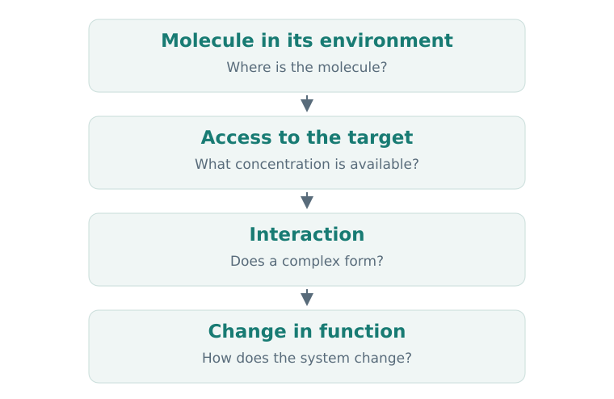
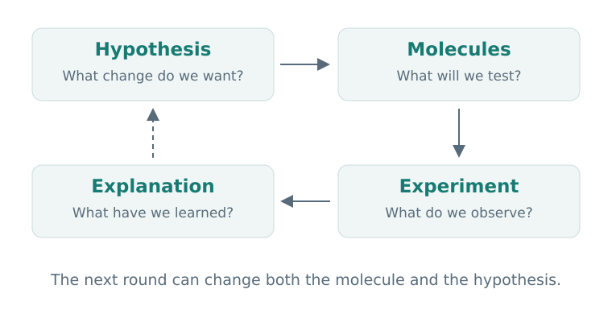

# Chapter 1. From Disease to Molecule

Imagine that we have found a molecule that binds very well to a protein. Have we found a drug? So far, we know about one interaction. We still need to find out whether it changes the protein's function, what happens to the cell, and whether the molecule can reach the right place in the body.

Drug discovery grows out of these connected questions: it is the search for, and investigation of, substances that might become medicines. Computation helps us move through this process by choosing hypotheses, comparing molecules, and planning experiments. To use it well, we first need to understand the problem itself.

## 1. Learning Objectives

After this chapter, you will be able to:

- explain the relationship between a disease, a target, and a molecule's action;
- distinguish a target, a hit, a lead, and a candidate;
- understand what changes when we move from an experiment on a protein to an experiment on cells;
- frame a computational task so that its result helps us choose the next step.

## 2. First, What Do We Want to Change?

A project begins with a proposed beneficial change: reducing a particular inflammatory signal, restoring a missing function, or stopping uncontrolled cell division. This does not yet identify a molecule, or necessarily even a protein.

The next question is what intervention could bring about that change. If we think an overactive enzyme sustains an unwanted process, we can test a hypothesis: reducing the enzyme's activity will change that process in the desired direction.

A **target** is the biological entity we intend to act on. It is often a protein: an enzyme, receptor, channel, or transporter. Other entities, including RNA, can also be targets. Our first examples will focus on protein targets.

Naming the target is not enough. We need to decide what to do to its function. We might want to inhibit one protein, activate another, or remove a third from the cell. The same change can also have different consequences in different tissues or physiological states.

A useful starting hypothesis therefore has three parts: **the entity, the direction of intervention, and the expected consequence**. “Protein X is associated with a disease” is an observation. “Reducing X's activity in particular cells will reduce the pathological process” is a testable hypothesis about an intervention.

## 3. From Interaction to Effect

Consider what must happen to a small molecule after it enters the body. It distributes between different environments, may bind other molecules, and can undergo chemical changes. Some of the original substance reaches the site we care about. There, it interacts with the target, and that interaction may change a biological process.

  
  
<em>Figure 1. Each transition raises a different question. Target binding is one step between the presence of a substance and a beneficial effect.</em>

This diagram separates several levels of observation. An experiment with a purified protein can investigate a molecule's interaction with that target. A cellular experiment adds a membrane, other proteins, metabolism, and signaling pathways. At the organism level, distribution between tissues and elimination also matter.

Suppose a molecule reduces the activity of a purified enzyme but does not change the cell's behavior. This is an informative result. Two possible explanations are that the molecule does not reach the enzyme inside the cell, or that changing the enzyme's activity is insufficient to produce the chosen cellular effect. These explanations lead to different next experiments.

This suggests an important habit: **ask which link in the chain we actually measured**. An experimental number becomes meaningful when we also know the biological entity, the conditions, and the response that was observed.

### 3.1 A Real Example

The history of imatinib illustrates the connection between a molecular hypothesis and a cellular test. BCR–ABL is a protein produced by a fusion between parts of two genes, and it has constitutively active tyrosine kinase function. In [Druker et al., 1996](https://doi.org/10.1038/nm0596-561), researchers tested an ABL inhibitor in cells containing BCR–ABL and observed inhibition of their growth.

Notice the transition: the hypothesis concerned an enzyme, while part of the test concerned cellular behavior. Later structural studies helped explain how imatinib sits within the ABL kinase domain. We will return to one such structure in Chapter 3. [Nagar et al., 2002](https://pubmed.ncbi.nlm.nih.gov/12154025/).

For now, the important point is the logic: a biological hypothesis guides the search, a molecule provides a way to intervene, and different experiments investigate different aspects of its action.

## 4. Two Ways to Begin a Search

### 4.1 Starting with a Target

In **target-based discovery**, we choose a target in advance and look for substances that affect it in the desired way. For example, we can measure an enzyme's activity in the presence of different compounds. Such an experiment is an **assay**: a method for measuring a particular property or response of a system.

This route has the advantage of a clear starting hypothesis. It is easier to connect the result to a specific molecular function. The usefulness of the chosen target still needs to be tested in a more complex biological context.

### 4.2 Starting with an Observed Effect

In **phenotypic discovery**, we begin with a desired change in a system. Researchers might look for compounds that change cell shape, restore a cellular process, or affect another measurable characteristic. Such an observable characteristic is called a **phenotype**.

An active compound can therefore be found before we know which target mediates its effect. The next task is to establish the mechanism. Researchers address it by comparing biochemical, genetic, structural, and other evidence.

Both routes can occur within one project. A chosen target leads us to cellular tests, while an unexpected cellular result can prompt us to investigate additional targets. Discovery is therefore usefully understood as a sequence of questions with feedback between them.

## 5. Hits, Leads, and Candidates

When a library of substances is screened for activity, the first interesting compounds are called **hits**. In practice, the definition depends on the project: the activity threshold, assay quality, and rules for confirmation all matter. In this course, we distinguish an initial signal from a **confirmed hit**, whose activity has been reproduced and examined with suitable additional measurements.

Promising **chemical series** are selected from these hits: groups of related structures that can be compared and modified. Researchers gradually investigate how structural changes affect properties. This leads to a **lead**: a compound or series suitable for further optimization. At this stage, several characteristics matter together, including activity, selectivity, solubility, stability, and the ability to obtain enough material.

A **candidate** is a compound selected for further development after a broader assessment against the project's requirements. The name itself does not mean that safety and efficacy in humans have already been established.

  
  
<em>Figure 2. Experimental results change both the molecules and our understanding of the problem. Each round helps formulate the next question.</em>

### 5.1 Why Properties Must Be Considered Together

Consider a teaching example. Two compounds reduce the activity of the same enzyme. A requires a lower concentration, but dissolves poorly under the conditions of a cellular experiment. B acts at a higher concentration, but dissolves better and produces a reproducible cellular response.

Which is more promising? The answer depends on the question. A may be useful for studying interactions with the purified protein. B may be more useful for the next cellular experiment. To develop the series, we might ask whether A's solubility can be improved while retaining its activity.

A **target product profile, or TPP**, helps guide these choices. It describes the intended use of the future therapy and the properties that will matter. Early in a project, it serves as a working framework: for example, whether a particular tissue must be reached and which route of administration is envisaged. More specific requirements for compounds are then developed from it. The [Harvard HMX syllabus](https://learn.hms.harvard.edu/programs/drug-discovery-approaches-discovering-and-designing-different-therapeutic-modalities) includes TPP in its introduction to small-molecule discovery.

## 6. Where Computation Helps

Computational methods work at different levels of this problem. Some compare structures, others predict properties or possible complex geometries, and still others help integrate biological evidence.

It is useful to describe each method through its inputs and outputs. A solubility model receives a representation of a molecule and returns an estimate of a particular property. Docking receives structures of the binding partners and searches for possible ligand poses in a chosen region of the protein. An activity model is trained on measurements of a particular kind.

The researcher's working question is usually broader than the model's output: “Which compounds should we test next?” Answering it requires connecting a prediction to an action.

Imagine having 1,000 compounds and the capacity to test 20. A model returns a number for each compound. We still need to decide whether all 20 should resemble a known hit, whether to include different chemical series, and how to handle compounds for which the model is unreliable. **A prediction becomes practically useful through a rule for selecting what to do.**

We can evaluate such a task: on data set aside in advance, compare the selected sets against a simple baseline, such as choosing the closest chemical analogues. We will explore this in later chapters and in the Hit Discovery volume. For now, notice the connection: input data → computation → selection → experiment → new data.

### 6.1 Data Must Preserve Context

The same structure can appear in dozens of records involving different targets, measurement types, and conditions. For later analysis, it is useful to retain at least the following information:

| Field | What question does it answer? |
| --- | --- |
| Structure and identifier | Which substance was studied? |
| Biological system | A purified protein, cells, or an organism? |
| Measured quantity | Binding, enzyme activity, or a cellular response? |
| Value and units | What was the numerical result? |
| Conditions and source | Under what conditions was it observed, and where is the method described? |

Without these connections, it is easy to compare numbers that answer different questions. In Foundations, we will learn to recover the context before building a model.

## 7. A Map of Therapeutic Approaches

Most examples in this volume involve **small molecules**. Chemical graphs provide a convenient way to describe them. Related compounds can be prepared through related synthetic routes, and their structures can often be modified in relatively small steps.

Drug discovery also encompasses other approaches. Antibodies exploit protein recognition; nucleic acids offer ways to affect the storage and use of genetic information; cell therapies work with living cells. These approaches differ in delivery, manufacturing, measurement, and design constraints. [Harvard HMX](https://learn.hms.harvard.edu/programs/drug-discovery-approaches-discovering-and-designing-different-therapeutic-modalities) provides a useful map of these modalities.

The common question remains: what intervention could produce the desired change, and what evidence would test it? The methods used to answer that question depend on the therapeutic approach.

## 8. Summary and Exercises

### 8.1 Summary

Drug discovery connects a biological hypothesis to a substance, measurements, and successive decisions. Each experiment answers its own question. A computational result is useful when we understand which action it helps us select and how that action will be tested.

### 8.2 Check Your Understanding

1. Formulate an intervention hypothesis that specifies an entity, the direction of change in its function, and the expected consequence. You may use a hypothetical protein X.
2. A compound binds a purified protein but does not change the measured cellular response. Suggest two explanations and, for each, one next observation that would help distinguish it from the alternative.
3. Why might the hit with the best activity in one assay be a less useful starting point than another hit?
4. You find a compound that changes a cell's phenotype. Do you know its target? What task comes next?

### 8.3 Choosing the Next Step

Consider three **hypothetical** compounds. A has reproducible activity against a purified enzyme but precipitates in the cellular experiment. B produces a reproducible cellular effect, but direct action on the proposed target has not been tested. C has produced one strong signal in the initial assay.

Propose the next check for each compound. Then choose one for further investigation and explain which uncertainty you want to reduce. There is no single required winner: assess the connection between your question and the experiment you choose.

**★ Extension.** How would your choice change if the aim were to obtain a tool for studying a specific protein rather than to start a drug development program?

In the next chapter, we will zoom in and examine which properties of a molecule can already be read from its structural formula.

## References and Further Reading

- [Druker et al., 1996. Effects of a selective inhibitor of the Abl tyrosine kinase on the growth of Bcr–Abl positive cells](https://doi.org/10.1038/nm0596-561). A landmark example of moving from a molecular target to a cellular test.
- [Nagar et al., 2002. Crystal structures of the kinase domain of c-Abl in complex with… imatinib](https://pubmed.ncbi.nlm.nih.gov/12154025/). How a structural observation complements a functional hypothesis.
- [Harvard HMX: Drug Discovery](https://learn.hms.harvard.edu/programs/drug-discovery-approaches-discovering-and-designing-different-therapeutic-modalities). A map of discovery stages and therapeutic modalities.
- [MIT–Harvard: Principles and Practice of Drug Development](https://www.principlespracticedrugdevelopment.org/). The broader development process and interdisciplinary work.
