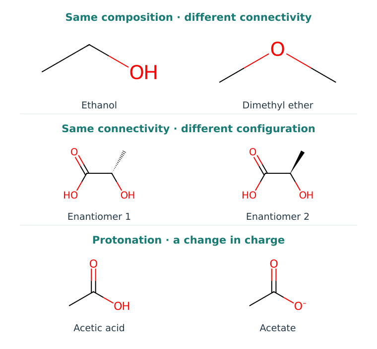
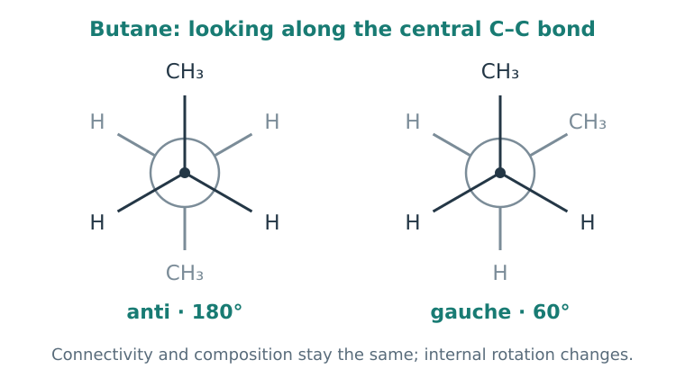

# Chapter 2. Reading Molecules

Two molecules can contain the same number of atoms of each element and behave differently. Sometimes moving a single bond or changing a group's arrangement in space is enough. Sometimes a structure drawn on a page changes its charge when placed in a different solution.

To understand these changes, we will learn to read a structural formula as a description of a molecule's physical possibilities. We will begin with connectivity, then add shape, charge, and the surrounding environment.

## 1. Learning Objectives

- Read a simple skeletal formula and identify functional groups.
- Distinguish connectivity, stereochemistry, and conformation.
- Explain why protonation depends on pH.
- Recognize which information a simplified molecular representation loses.

## 2. Molecular Formula and Structure

The formula C₂H₆O tells us which atoms are present and how many of each there are. It does not tell us how they are connected. Ethanol, CH₃–CH₂–OH, and dimethyl ether, CH₃–O–CH₃, have the same composition but different connectivity.

In ethanol, oxygen is bonded to hydrogen; in the ether, it connects two carbon atoms. This changes the interactions the molecule can make with its surroundings. We can already see why molecular mass alone is insufficient to describe a substance.

  
  
<em>Figure 1. The top pair changes connectivity while retaining composition. The middle pair changes spatial configuration while retaining connectivity. The bottom pair changes protonation state. Structures were drawn from explicit SMILES using RDKit.</em>

**Constitutional isomers** have the same composition and different connectivity. A computer can naturally represent this level as a graph: vertices are atoms and edges are bonds. A vertex can have properties such as element and formal charge; an edge can have a bond type.

The heavy-atom graph of ethanol is the path C–C–O. The corresponding graph of dimethyl ether is C–O–C. Remove the element labels and both become the same three-vertex path. Chemically, however, those labels matter: they tell us which atom is in the middle.

This is our first example of a general representation problem. **If the features do not preserve a distinction needed for the task, a model cannot recover it from those features.** In the [first practical exercise](../part2/index.md), we will examine this using small graphs and no external libraries.

### 2.1 Reading a Skeletal Formula

Organic chemists do not always draw every atom and every hydrogen. In a skeletal formula, a corner or an unlabeled line endpoint usually represents carbon. Hydrogens bonded to carbon are often omitted; their number is inferred from valence. Other elements, such as N, O, and Cl, are labeled explicitly.

One, two, or three lines represent a single, double, or triple bond. In the simplest neutral examples, carbon forms four bonds when bond order is counted: a double bond counts as two. This is a useful starting point; charges and special cases must be considered separately.

In CH₃–CH₂–OH, for example, the first carbon is connected to the second carbon and three hydrogens. The second is connected to the first carbon, oxygen, and two hydrogens. Oxygen is connected to carbon and hydrogen. Simplifying the drawing does not remove atoms from the molecule; it changes how we record them.

## 3. Why Functional Groups Matter

Electrons are not always shared equally within a bond. A more electronegative atom attracts electron density more strongly. An O–H bond is therefore polar: the regions near O and H interact differently with surrounding charges and dipoles.

A useful first step is to recognize **functional groups**: fragments with characteristic chemical capabilities. An alcohol group contains O–H. A carbonyl group contains C=O. A carboxyl group combines C=O and O–H at one carbon. An amine contains nitrogen in a particular bonding environment; an amide has nitrogen adjacent to a carbonyl group.

These names make molecules easier to discuss, but neighboring atoms also affect behavior. For example, the nitrogen lone pair in an amide participates in conjugation with the carbonyl group. That nitrogen therefore behaves differently from nitrogen in a simple amine.

### 3.1 Hydrogen-Bond Donors and Acceptors

A **hydrogen-bond donor** provides a suitable hydrogen bonded to an electronegative atom. An **acceptor** provides a region of electron density that can participate in this interaction. In many simple neutral alcohols, oxygen can act as an acceptor and O–H as a donor. An ether has an oxygen acceptor but no O–H group.

We could therefore identify a meaningful distinction in our first comparison of ethanol and dimethyl ether. Counting N and O atoms, however, is not the same as counting donors and acceptors. Bonding, charge, and electronic environment matter. A protonated amine, for example, no longer has an available nitrogen lone pair for the usual acceptor role. The resulting N–H group can act as a donor: protonation changes the set of possible interactions.

These capabilities also depend on geometry. Two compatible groups must be at suitable distances and orientations. In the binding chapter, we will add another part of the picture: before meeting each other, both groups were already interacting with water.

## 4. The Same Connectivity in Different Spatial Arrangements

A carbon atom with four single bonds often has an approximately tetrahedral environment. A flat drawing therefore hides important information about the arrangement of its substituents.

A tetrahedral carbon bonded to four different substituents is a stereogenic center. Two mirror-image arrangements may not be superimposable by rotating the whole molecule. Such mirror-image stereoisomers are called **enantiomers**. Figure 1 shows a pair for lactic acid; the wedge bond indicates a spatial direction.

A protein environment also has a particular three-dimensional arrangement. Two enantiomers can therefore form different sets of contacts with it. The same molecular formula and list of bonds do not guarantee the same biological behavior.

The labels **R** and **S** describe configuration according to substituent-priority rules. The letter does not tell us which isomer is more active or which way it rotates plane-polarized light. Those questions require additional information.

### 4.1 Configuration and Conformation

Now imagine ethanol and rotate part of the molecule around a single bond. Its composition and connectivity remain unchanged, but the relative positions of its atoms change. Such a spatial arrangement is called a **conformation**.

Different conformations can interconvert through internal motion. The rate depends on the energy barrier. We do not assume that every single bond rotates completely freely: conjugation, rings, and atomic clashes can strongly restrict motion.

Look along the central C–C bond in butane. We represent the front carbon with a dot and the rear carbon with a circle: they lie one behind the other along our line of sight. Each has one CH₃ group and two hydrogens attached. Rotating the rear part around this bond changes the angle between the directions toward the CH₃ groups while leaving the bonds unchanged.

  
  
<em>Figure 2. Newman projections of two butane conformations. The dihedral angle between the CH₃ groups is 180° in anti and 60° in gauche. The dot and circle represent the front and rear carbon atoms, not additional atoms or bonds.</em>

Changing a conformation and converting one stable enantiomer into the other are different tasks. Ordinary bond rotation does not change the configuration of a stable tetrahedral center. It is therefore useful to separate three questions:

| Level | What do we ask? |
| --- | --- |
| Connectivity | What is connected to what? |
| Configuration | What is the fixed spatial arrangement, for example at a stereocenter? |
| Conformation | Where are the atoms in a particular state of internal motion? |

In molecular modeling, this distinction determines what we are searching for. Generating conformers of one molecule usually preserves the specified configurations of its stereocenters.

## 5. A Molecule Can Change Charge in Solution

So far, we have imagined an isolated molecule. In solution, it interacts with its surroundings, and some groups can donate or accept a proton.

Consider a simple acid:

$$
\mathrm{HA \rightleftharpoons H^+ + A^-}.
$$

HA is the protonated form and A⁻ the deprotonated form. In water, H⁺ is shorthand for a hydrated proton. At a specified temperature and medium composition, the acid dissociation constant Kₐ describes this equilibrium. In the ideal dilute-solution approximation:

$$
K_a\approx\frac{[H^+]}{c^\circ}\frac{[A^-]}{[HA]},
\qquad c^\circ=1\ \mathrm{M}.
$$

The standard concentration $c^\circ$ makes the expression dimensionless. We usually use $pK_a=-\log_{10}K_a$ and, under the same approximation, $\mathrm{pH}=-\log_{10}([H^+]/c^\circ)$. The prefix p denotes a negative base-10 logarithm: for example, $10^{-5}$ becomes 5.

The logarithm of a product is the sum of the logarithms. Applying this to the definition of Kₐ gives $pK_a=\mathrm{pH}-\log_{10}([A^-]/[HA])$. Rearranging gives the **Henderson–Hasselbalch equation**:

$$
\mathrm{pH}=pK_a+\log_{10}\frac{[A^-]}{[HA]}.
$$

Square brackets denote concentration. The equation shows that the key quantity is **the difference between pH and pKₐ**. At pH = pKₐ, the two forms have equal concentrations. If pH is one unit above pKₐ, [A⁻]/[HA] is 10. You can review the underlying equilibrium in the [section on acid strength](https://openstax.org/books/organic-chemistry/pages/2-8-acid-and-base-strength).

### 5.1 A Worked Example

For a **hypothetical monoprotic acid**, set pKₐ = 5.0 and pH = 6.0. Then:

$$
\frac{[A^-]}{[HA]}=10^{6-5}=10.
$$

This is a ratio of the two forms, not their fractions. To obtain the fraction of A⁻, divide its concentration by the total:

$$
f_{A^-}=\frac{[A^-]}{[A^-]+[HA]}=\frac{10}{10+1}\approx0.909.
$$

About 91% of the molecules are in the deprotonated form in this model. At pH = 4.0, the ratio becomes 0.1 and the fraction of A⁻ is about 9%. The carbon skeleton is unchanged, but the distribution of charge states changes substantially.

For a base, a useful expression is $\mathrm{BH^+\rightleftharpoons B+H^+}$. Here pKₐ refers to the conjugate acid BH⁺. As pH increases, the fraction of neutral base B increases. This is why “the molecule's pKₐ” needs clarification: which group and which equilibrium are we discussing?

A molecule with several interacting acidic and basic centers is more complicated. The single-group approximation teaches us how to read an equilibrium, but cannot simply be extended to every possible state.

### 5.2 Tautomerism: Another Kind of Difference

**Tautomers** differ in proton and bond positions and can interconvert. In a keto–enol pair, for example, proton movement is accompanied by a change in the double-bond position. This can change donor and acceptor locations and interactions with a protein.

This differs from two resonance structures: resonance drawings describe the electronic structure of one state, rather than molecules switching between separate pictures.

When preparing a substance for a calculation, we therefore choose more than its name. We choose a specific representation: stereochemistry, protonation state, tautomer, and starting conformation.

## 6. The Environment Is Part of the Problem

Polar and charged regions of a molecule interact with water. Nonpolar regions also affect how the solvent is organized. When a molecule moves from water into another environment, its entire set of interactions changes.

Adding a polar group can therefore change several properties at once: target interactions, solubility, distribution between environments, and preferred conformations. The direction of the overall change depends on the context.

Suppose an O–H group is added to a fragment in the hope of making a new protein contact. First, we need to check whether the group fits and is oriented appropriately. Next, we must consider what it loses when leaving water and how it affects the molecule's other states. This way of asking questions will return throughout structure-based design.

## 7. What the Computer Sees

**SMILES** encodes molecular structure as a sequence of characters. For example, `CCO` describes ethanol and `COC` describes dimethyl ether. `OCC` can also describe ethanol: traversal of the same graph began at the other end. The principles of this notation were formalized in [Weininger, 1988](https://doi.org/10.1021/ci00057a005).

This gives us two requirements for a representation. It should retain important chemical differences while avoiding artificial differences caused by an arbitrary order of writing.

If a model changes its prediction merely because we renumber the atoms of the same structure, we should check its **permutation invariance**. If it always treats two stereoisomers as identical, we should check whether stereochemical information was provided. Chemical concepts thus become concrete questions about code.

We will study representations in detail in Chapter 6. For now, it is enough to understand why a string is not the molecule itself.

## 8. Summary and Exercises

### 8.1 Summary

Composition, connectivity, stereochemistry, conformation, and protonation state answer different questions. The environment and the molecule's accessible states also matter for interactions. A good representation preserves the distinctions needed for the task.

### 8.2 Check Your Understanding

1. Why is C₂H₆O insufficient to specify a structure? Draw two possible molecules.
2. Which hydrogen-bonding capabilities distinguish ethanol from dimethyl ether?
3. Two drawings differ by rotation around a single bond. How can you check whether they describe different conformations or different configurations?
4. Why does identical atomic connectivity not guarantee identical interaction with a protein?

### 8.3 Exercises

5. A hypothetical monoprotic acid has pKₐ = 6.0. Calculate the deprotonated fraction at pH 5.0, 6.0, and 7.0. First predict the ordering of the values.
6. For a hypothetical base, the pKₐ of its conjugate acid BH⁺ is 8.0. Which form predominates at pH 7.0? Calculate the fraction of B.
7. A representation stores only the numbers of C, N, and O atoms. Which distinctions from this chapter will it lose? Which can be retained by a graph with elements and bond orders but no stereochemical labels?
8. Complete the [molecular identity practical](../part2/index.md). Explain why atom labels must be preserved but their arbitrary numbers need not be.

**★ Extension.** Starting from HA ⇌ H⁺ + A⁻, derive $f_{A^-}=1/(1+10^{pK_a-\mathrm{pH}})$. Which assumptions allow the system to be described using only two forms?

We now have a language for describing a molecule. In the next chapter, we will apply it to a much larger partner: a protein.

## References and Further Reading

- [Weininger, 1988. SMILES, a chemical language and information system](https://doi.org/10.1021/ci00057a005). A landmark paper on the textual representation of molecular connectivity; a detailed discussion follows in Chapter 6.
- [RDKit: Getting Started in Python](https://www.rdkit.org/docs/GettingStartedInPython.html). Official examples of reading, drawing, and comparing structures.
- [OpenStax / McMurry: Acid and Base Strength](https://openstax.org/books/organic-chemistry/pages/2-8-acid-and-base-strength). A textbook explanation of Kₐ, pKₐ, and conjugate pairs for reviewing the basics.
- [IUPAC Gold Book](https://goldbook.iupac.org/). A reference for clarifying chemical terminology.
