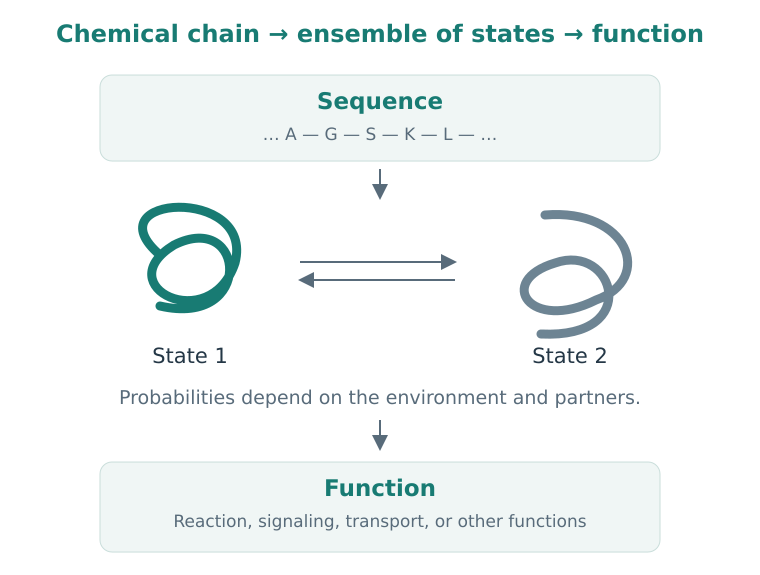

# Chapter 3. Proteins in Motion

We have learned to look beyond a structural formula and see bonds, shape, and charge. A protein is made of the same physical objects: atoms and bonds. Its size and organization allow it to perform complex work, such as accelerating reactions, transmitting signals, and transporting substances across membranes.

To understand how a molecule changes that work, we need to connect three things: the protein's sequence, its spatial states, and its function. We will start with how a protein is built, then examine what a ligand can change.

## 1. Learning Objectives

- Explain how a protein's sequence differs from its structure.
- Distinguish a binding pocket, a catalytic function, and a cellular effect.
- Understand why a protein should be viewed as a dynamic system.
- Read a structure entry while recognizing its provenance and limits.

## 2. From Amino Acid to Chain

Proteins consist of amino acid residues joined by peptide bonds. Most common amino acids share a backbone unit and differ in their side chains. These side chains contain nonpolar, polar, acidic, and basic groups: the chemical capabilities introduced in the previous chapter.

Joining amino acids produces a repeating **backbone**. The order of residues is called the **primary structure**, and its textual representation is the sequence. Amino acids are represented using one-letter or three-letter codes.

The chain has a direction, from the N-terminus to the C-terminus. This matters both for biosynthesis and for recording data. Two sequences cannot be treated as identical simply by reading one backward.

A side chain can change local interactions, but its role depends on its environment. A charged residue on the surface contacts water; a similar residue inside the protein experiences a different environment. Even a familiar functional group therefore gains meaning from its location.

## 3. How a Chain Organizes in Space

A peptide bond has partial double-bond character, which restricts rotation around it. Rotation around neighboring backbone bonds allows the chain to change direction. Not every combination of angles is equally accessible: atoms cannot freely pass through one another.

Locally, the chain often forms repeating structures. In an **α-helix**, the backbone coils into a helix; in a **β-sheet**, extended segments form a sheet. Backbone hydrogen bonds are among the interactions that stabilize these elements. They are called secondary structure.

The overall spatial organization of a single chain is its tertiary structure. Several chains can form a functional complex, giving rise to quaternary structure. These names are useful levels of description, but do not by themselves explain what the protein does.

  
  
<em>Figure 1. Sequence specifies the chain's chemical organization. In a given environment, the protein occupies a set of states through which it performs its function. This is a conceptual diagram; the shapes are not coordinates of a real protein.</em>

### 3.1 Why a Protein Folds

Changing the chain's shape changes its internal interactions and its interactions with the surroundings. Some arrangements bury nonpolar regions away from water; others create favorable contacts or reduce atomic clashes. At the same time, ordering the chain restricts the number of states it can access.

The outcome depends on the balance between these factors. In the next chapter, we will describe a related balance using free energy. For now, the key point is that a suitable shape emerges in a particular environment and depends on the chain's chemical organization.

Anfinsen's work on protein folding provides a historical introduction. It connected information in the sequence with the ability to recover structure and activity under suitable conditions. For further reading, see [Anfinsen, 1973](https://doi.org/10.1126/science.181.4096.223) and his [Nobel Lecture](https://www.nobelprize.org/prizes/chemistry/1972/anfinsen/lecture/).

This idea does not require every protein always to have one stable shape. Proteins can contain flexible segments and disordered regions, form complexes with partners, and respond to their environment. Other molecular systems also participate in protein folding and maintenance inside cells.

## 4. A Structure Describes a State

When we open a PDB file, we see atomic coordinates in a structural model. Such a model may have been obtained from X-ray diffraction, cryo-EM, NMR, or a computational prediction. Its origin matters: the methods observe the system differently and have different sources of uncertainty.

For example, an experimental model may omit flexible regions for which the data are insufficient. A structure may contain a selected protein domain rather than the full chain. Additional partners and substances may be present under the conditions of the study.

It is therefore useful to ask: **exactly what entity do these coordinates represent?** The protein name is only the beginning of the answer. We need to know the sequence, organism, mutations, partners, and method used to obtain the structure.

### 4.1 A Protein Occupies Multiple States

Protein atoms move. Sometimes they make small fluctuations; sometimes a loop changes position or domains change their relative arrangement. Different states have different probabilities and may support different functions.

Imagine a protein whose pocket alternates between more open and more closed states. A ligand interacts more favorably with the open state. Introducing the ligand can shift the distribution of states because the bound forms gain additional stabilization. In other cases, further rearrangements of the protein and ligand follow their initial contact.

The terms **conformational selection** and **induced fit** describe these aspects of recognition. Both mechanisms can contribute to a real process. One final picture of a complex usually cannot reveal the entire route by which it formed.

The classic paper by [Monod, Wyman, and Changeux, 1965](https://doi.org/10.1016/S0022-2836(65)80285-6) proposes a model connecting binding with the distribution between conformational states. It is a historical source for deeper study; its particular assumptions about subunits and transitions are not a universal description of every protein.

## 5. Which Functions Can We Target?

### 5.1 Enzymes: Changing Reaction Rates

An **enzyme** accelerates a chemical reaction. It helps the system move from reactants to products along a path with a lower activation barrier. A catalyst does not change the equilibrium position of the reaction itself.

An enzyme often has a region where a substrate binds and catalysis takes place. An inhibitor can obstruct substrate binding, affect catalytic groups, or change the enzyme's accessible states.

Kinases are enzymes that transfer a phosphate group, often from ATP to another substrate. Their activity can participate in cellular signaling. A molecular change in kinase activity can therefore affect processes farther along a signaling pathway. The actual consequences must be investigated in the relevant system.

### 5.2 Receptors: Changing the Probability of a Response

A **receptor** recognizes a signal and participates in transmitting a response. A ligand that activates a receptor is called an agonist. An antagonist opposes an agonist's action; binding by the antagonist does not imply the same functional response.

This illustrates the distinction between **affinity**, a property of binding, and **efficacy**, the ability to produce a response in a particular system. Two substances can bind the same receptor yet affect its function differently.

### 5.3 Other Ways to Intervene

Channels regulate ion passage, transporters move substances, and structural and regulatory proteins organize cellular processes. Beyond changing a protein's current activity, we can also affect its abundance. Targeted protein degradation, for example, aims to remove a protein through cellular degradation machinery.

You do not need to memorize every class at this stage. A more useful question is: **which protein activity are we changing, and how will we detect that change?** The answer determines the choice of assay and the meaning of the computational task.

## 6. Where a Ligand Binds

A **binding site** is the region with which a ligand interacts. It is often convenient to describe it as a pocket, but it need not be a rigid cavity. It can lie on a surface, at a domain boundary, or between protein partners.

A pocket has both geometry and chemical properties. One region may provide a hydrogen-bond donor, another a charged group, and a third a nonpolar surface. To discuss a proposed interaction, we need to connect this map with the ligand's chemistry.

Binding at an **allosteric site** changes function by influencing other regions or states of a protein. Distance from the catalytic center does not rule out a functional effect. The mere presence of a molecule on the surface, however, does not establish such a connection.

### 6.1 Returning to ABL

We encountered imatinib in Chapter 1. The entry [PDB 1IEP](https://www.rcsb.org/structure/1IEP) represents the mouse c-ABL kinase domain in complex with this compound. It is an X-ray structure at 2.10 Å resolution, rather than a structure of full-length human BCR–ABL inside a cell.

The associated paper, [Nagar et al., 2002](https://pubmed.ncbi.nlm.nih.gov/12154025/), shows that imatinib binds in the ATP-binding region and stabilizes a particular inactive conformation. This connects the ligand's position to the enzyme's state.

This example is also a useful exercise in reading data. A drug's history, its protein target, and a particular structure entry are connected, but describe different entities and levels of investigation. When opening an entry, we must preserve its precise identity.

## 7. From Protein to Cell

Suppose we have convincingly shown that a molecule binds a protein and reduces its activity. Explaining the cellular effect still requires more questions. Is that protein present in the cells being studied? Does the molecule reach it? How much do other processes compensate for the change?

A compound can also interact with several proteins. **Selectivity** always involves a comparison: which targets, under what conditions, and using which measurement? Knowing about one strong interaction does not tell us about all the others.

We will return to these questions in the Target Discovery and Target Deconvolution volumes. For now, we have the necessary foundation: a protein is a chemical, dynamic system, and its function exists in a particular context.

## 8. Summary and Exercises

### 8.1 Summary

Sequence specifies a protein's chemical organization. Structural states help us understand its functions and interactions. The coordinates of a particular model are useful when we know which entity and conditions they describe.

### 8.2 Check Your Understanding

1. How do protein sequence, structure, and function differ? Give one question answered at each level.
2. Why does an image of a complex not show the entire process by which it formed?
3. Two ligands bind the same receptor, but only one produces the chosen response. Which two concepts help describe this difference?
4. Why might a region far from the active site be useful for design?

### 8.3 Working with a Structure Entry

5. Open [1IEP](https://www.rcsb.org/structure/1IEP). Record the method, organism, protein construct, and ligand. Which description is more precise: “a structure of the disease protein” or “a structure of a particular domain with a particular ligand”? Explain what information the first description loses.
6. **Hypothetical situation:** part of a loop is unresolved in a structure. Can you conclude that the loop is absent from the protein studied? What information should you check?
7. Suppose a ligand prefers a rare protein state. What questions about structure preparation and conformation selection should you ask before docking?

**★ Extension.** Suggest two explanations for a case where inhibition of a purified enzyme is confirmed but the expected cellular effect is absent. Identify which explanation concerns the molecule and which concerns the biological hypothesis.

In the next chapter, we will turn “binding” into a quantitative model. It will let us calculate the fraction of protein occupied by a ligand and how that fraction depends on concentration.

## References and Further Reading

- [Anfinsen, 1973. Principles that govern the folding of protein chains](https://doi.org/10.1126/science.181.4096.223). A historical paper connecting sequence, folding, and function.
- [Monod, Wyman & Changeux, 1965. On the nature of allosteric transitions: a plausible model](https://doi.org/10.1016/S0022-2836(65)80285-6). A classic model connecting ligand binding with conformational states.
- [Nagar et al., 2002](https://pubmed.ncbi.nlm.nih.gov/12154025/) and [PDB 1IEP](https://www.rcsb.org/structure/1IEP). A concrete example of a kinase–inhibitor complex.
- [Stanford CS279](https://web.stanford.edu/class/cs279/). A university route for further study of structure and dynamics.
