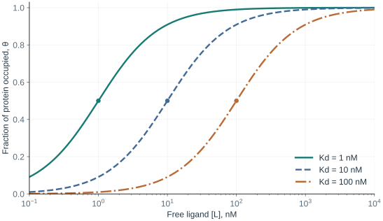
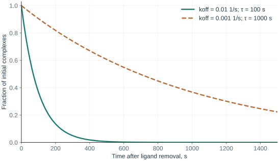

# Chapter 4. What Does “Binding” Mean?

Molecules in solution are constantly moving. A ligand encounters a protein, forms a complex, and may then separate from it. Even when the average fraction of bound proteins stays constant, individual complexes continue to form and dissociate.

In this chapter, we will build a simple model of that process. Three distinct questions will emerge: how favorable is binding, what fraction of protein is occupied, and how quickly does the system change? Each question needs its own quantity.

## 1. Learning Objectives

- Derive the relationship between Kd, free ligand concentration, and occupancy.
- Check dimensions and use a logarithmic affinity scale.
- Explain why identical Kd values do not imply identical complex lifetimes.
- Recognize when the approximation “added concentration equals free concentration” breaks down.

## 2. The Simplest Model

Let P denote free protein, L free ligand, and PL their complex:

$$
\mathrm{P+L\underset{k_{off}}{\stackrel{k_{on}}{\rightleftharpoons}}PL}.
$$

We assume that the protein has one independent binding site, the complex contains one ligand molecule, binding is reversible, and the medium is homogeneous. There are no other reactions in this model. These assumptions make the problem simple enough to follow from beginning to end.

Encounters become more likely as the concentration of either partner increases. The complex formation rate in the model is therefore proportional to $[P][L]$:

$$
v_{on}=k_{on}[P][L].
$$

The dissociation rate is proportional to the concentration of complexes already present:

$$
v_{off}=k_{off}[PL].
$$

If concentrations are measured in moles per liter, or M, the units of $k_{on}$ are M⁻¹s⁻¹ and those of $k_{off}$ are s⁻¹. Both rates then have units of M/s. This dimensional check is a quick way to catch a mix-up between quantities.

## 3. Equilibrium and Kd

At equilibrium, the rates of complex formation and dissociation are equal:

$$
k_{on}[P][L]=k_{off}[PL].
$$

Rearranging to collect the concentrations gives:

$$
K_d=\frac{k_{off}}{k_{on}}=\frac{[P][L]}{[PL]}.
$$

This defines the **dissociation constant Kd**. Under our concentration approximation, it has units of concentration. A smaller Kd means that, all else being equal, a lower free ligand concentration is sufficient for substantial binding. This corresponds to higher affinity.

“Equilibrium” does not mean that the molecules have stopped. It means that average concentrations no longer change in one direction: on average, as many complexes form per unit time as dissociate.

Kd refers to particular partners and conditions. Temperature, pH, medium composition, and protein state can change the observed interaction. It is therefore useful to record the conditions alongside the number.

## 4. What Fraction of Protein Is Occupied?

The total protein concentration is the sum of free and bound protein:

$$
[P]_{tot}=[P]+[PL].
$$

**Occupancy**, the fraction of protein molecules occupied, is:

$$
\theta=\frac{[PL]}{[P]_{tot}}=\frac{[PL]}{[P]+[PL]}.
$$

The definition of Kd gives $[P]=K_d[PL]/[L]$. Substitute this into the denominator and cancel $[PL]$:

$$
\theta=\frac{1}{K_d/[L]+1}
=\boxed{\frac{[L]}{K_d+[L]}}.
$$

We can now read the properties of the curve without writing a program. If there is almost no free ligand, occupancy is near zero. If the free ligand concentration is much larger than Kd, occupancy approaches one. At $[L]=K_d$, it is exactly 1/2.

### 4.1 A Numerical Example

Take a **hypothetical binding pair** with Kd = 10 nM. We will express all quantities in the fraction in nM:

| Free ligand [L] | Calculation | Occupancy |
| --- | --- | --- |
| 1 nM | 1 / (10 + 1) | 9.1% |
| 10 nM | 10 / (10 + 10) | 50% |
| 90 nM | 90 / (10 + 90) | 90% |
| 990 nM | 990 / (10 + 990) | 99% |

Moving from 90% to 99% required an elevenfold increase in free concentration. As sites fill, the remaining free sites become rare, and the curve approaches saturation gradually.

<div align="center">
  
  <p><em>Figure 1. Exact curves for a single independent binding site at equilibrium. Kd values are chosen for teaching; the plot contains no experimental data. A logarithmic concentration axis makes it possible to compare several orders of magnitude.</em></p>
</div>

### 4.2 Predict the Result

First set the free concentration equal to Kd. Then increase Kd tenfold while keeping the concentration unchanged. What should happen to occupancy?

```python
# Concentrations are in nM.
ligand_free = 10
for kd in (10, 100):
    occupancy = ligand_free / (kd + ligand_free)
    print(kd, round(100 * occupancy, 2))
```

Perform the calculation yourself, then compare it with the [complete practical](../part2/Chapter2_Binding-Model.md). The code, table, and figure use the same analytical model.

### 4.3 Two Different Meanings of “Stronger”

Suppose A has Kd = 10 nM and B has Kd = 100 nM. At the same free concentration, A will occupy a larger fraction of otherwise identical protein sites. If the concentrations differ, however, Kd alone is insufficient.

At $[A]=10$ nM, A's occupancy is 50%. At $[B]=1000$ nM, B's occupancy is about 91%. We therefore need to distinguish “Which compound has stronger binding affinity?” from “What fraction of the target is occupied under these conditions?”

Moving from occupancy to function also requires a model. If a bound ligand blocks an enzyme, the occupied fraction may be related to a reduction in activity. For a receptor, its states and the ligand's ability to trigger a response also matter. A biological effect does not follow automatically from a single value of θ.

## 5. Added and Free Concentrations

The equation uses **free** ligand concentration. In the laboratory, we often know the total amount added:

$$
[L]_{tot}=[L]+[PL].
$$

If only a small fraction of the added ligand binds, it is convenient to approximate $[L]\approx[L]_{tot}$. When complex formation consumes an appreciable amount, this approximation overestimates the free concentration.

Consider a **teaching example** with total protein concentration 100 nM, total ligand concentration 100 nM, and Kd = 10 nM. Substituting the added 100 nM into the simple equation gives about 91%. After binding, however, the free ligand concentration will be below 100 nM.

Let $x=[PL]$. Then $[P]=[P]_{tot}-x$ and $[L]=[L]_{tot}-x$. Substituting into the definition of Kd:

$$
K_d=\frac{([P]_{tot}-x)([L]_{tot}-x)}{x}.
$$

Expanding the brackets gives a quadratic equation:

$$
x^2-([P]_{tot}+[L]_{tot}+K_d)x+[P]_{tot}[L]_{tot}=0.
$$

We need the root that does not exceed the total concentration of either partner. For these values, $x\approx72.98$ nM. The free ligand concentration is therefore about 27.02 nM, and occupancy is 72.98%.

The difference from 91% does not arise from a new kind of binding. We have simply accounted for mass balance more accurately. [Jarmoskaite et al., 2020](https://doi.org/10.7554/eLife.57264) discusses this and other conditions needed for binding measurements.

## 6. From Affinity to Free Energy

Complex formation changes the entire system: protein, ligand, and solvent. New contacts form, some previous interactions with water change, and the range of accessible motions can narrow or expand.

**Gibbs free energy** brings these contributions together. At a specified temperature:

$$
\Delta G=\Delta H-T\Delta S.
$$

ΔH describes the enthalpic contribution, ΔS the entropy change, and T the absolute temperature. A simple rule such as “more contacts means better binding” does not account for all these contributions.

In the ideal dilute-solution approximation, the standard binding free energy is related to Kd by:

$$
\Delta G^\circ_{bind}=RT\ln\left(\frac{K_d}{c^\circ}\right),
\qquad c^\circ=1\ \mathrm{M}.
$$

R is the gas constant. The ratio inside the logarithm is dimensionless, so Kd must first be expressed in M. Dividing by the standard concentration cannot be replaced by inserting a number expressed in whichever units happen to be convenient.

For example, 10 nM = $10^{-8}$ M. At T = 298 K, the standard binding free energy of this **hypothetical system** is about −45.6 kJ/mol. This is ΔG° for the chosen standard state; the actual reaction free-energy change at equilibrium concentrations is zero.

### 6.1 What a Tenfold Improvement Means

Compare Kd = 100 nM and 10 nM at the same temperature. The difference in standard free energies is:

$$
\Delta\Delta G^\circ=RT\ln\frac{10}{100}
=-RT\ln10\approx-5.7\ \mathrm{kJ/mol}.
$$

This relatively small difference on molecular energy scales corresponds to a full order of magnitude in Kd. The logarithmic relationship explains why modest changes in the overall energetic balance can noticeably shift affinity.

For the same reason, affinity is often expressed as $pK_d=-\log_{10}(K_d/1\mathrm{M})$. At 100 nM, pKd = 7; at 10 nM, it is 8. A higher pKd means a lower Kd and higher affinity under comparable conditions.

## 7. The Same Equilibrium, Different Rates

We derived $K_d=k_{off}/k_{on}$. Different pairs of values can give the same ratio:

| Hypothetical system | kon, M⁻¹s⁻¹ | koff, s⁻¹ | Kd |
| --- | --- | --- | --- |
| A | $10^6$ | $10^{-2}$ | 10 nM |
| B | $10^5$ | $10^{-3}$ | 10 nM |

At the same free concentration, after reaching equilibrium, their occupancies will be identical. B, however, forms and loses its complex more slowly.

Imagine removing the free ligand so that no rebinding occurs. Only dissociation remains:

$$
\frac{d[PL]}{dt}=-k_{off}[PL],
\qquad [PL](t)=[PL](0)e^{-k_{off}t}.
$$

The mean complex lifetime in this model is $\tau=1/k_{off}$. It is 100 s for A and 1000 s for B. The time by which half of the original complexes have dissociated is different: $t_{1/2}=\ln2/k_{off}$.

<div align="center">
  
  <p><em>Figure 2. Normalized complex concentration after free ligand removal. This teaching model assumes no rebinding; identical Kd values do not make these curves identical.</em></p>
</div>

In a living system, the ligand can rebind, the protein can change state, and protein turnover can occur. A substance's duration of action therefore cannot simply be equated to $1/k_{off}$. Even this simple model, however, shows why equilibrium and kinetic properties complement one another.

## 8. Summary and Exercises

### 8.1 Summary

Kd describes an equilibrium interaction under specified conditions. Occupancy also depends on the free concentration. Complex formation and dissociation rates determine how the system approaches equilibrium and moves away from it.

### 8.2 Check Your Understanding

1. Why do complexes continue to form and dissociate at equilibrium?
2. How can you check the units in $K_d=k_{off}/k_{on}$?
3. Why does the occupancy equation use free concentration?
4. What does koff tell us when Kd is already known?

### 8.3 Exercises

All values below are hypothetical. Use the single independent binding-site model.

5. Kd = 20 nM. Calculate occupancy at free concentrations of 2, 20, and 180 nM. First estimate the answers without a calculator.
6. Derive the free concentration required for a specified occupancy. What concentration is needed for θ = 0.95 when Kd = 20 nM?
7. Convert Kd = 50 nM to pKd. How does pKd change when Kd decreases tenfold?
8. Two systems have the same Kd = 10 nM. The first has kon = $2\times10^5$ M⁻¹s⁻¹; the second has kon = $2\times10^6$ M⁻¹s⁻¹. Find koff and the mean complex lifetime for each.
9. Complete the [binding practical](../part2/index.md). In the ligand-depletion example, check that neither free nor bound concentrations become negative.

**★ Extension.** At constant free ligand concentration L, show that the rate constant for approach to equilibrium is $k_{on}[L]+k_{off}$. Why can a short incubation time interfere with measuring Kd?

The next chapter will examine experiments: how an observed signal becomes a system property, and why Kd, Ki, IC50, and EC50 answer different questions. It is currently listed in the [course syllabus](../index.md#syllabus).

## References and Further Reading

- [Jarmoskaite et al., 2020. How to measure and evaluate binding affinities](https://doi.org/10.7554/eLife.57264). Equilibrium conditions, concentration ranges, and interpretation of binding assays.
- [Monod, Wyman & Changeux, 1965](https://doi.org/10.1016/S0022-2836(65)80285-6). A classic extension to more complex systems with coupled conformational states.
- [Stanford CS279](https://web.stanford.edu/class/cs279/). Further study of energies and molecular dynamics.

The numerical examples and plots in this chapter are calculated from explicitly stated teaching parameters. They are not experimentally measured affinities for any drug.
