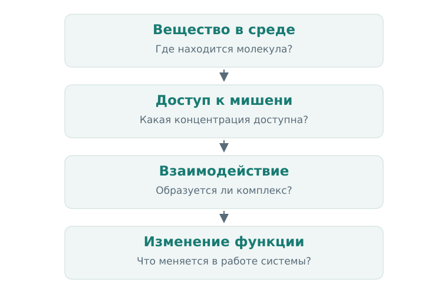
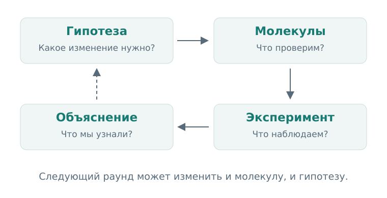

# Глава 1. От болезни к молекуле

Представим, что мы нашли молекулу, которая очень хорошо связывается с белком. Стала ли она лекарством? Пока мы знаем только об одном взаимодействии. Нам ещё предстоит выяснить, меняет ли оно работу белка, что происходит с клеткой и сможет ли молекула добраться до нужного места в организме.

Из таких связанных вопросов складывается drug discovery — поиск и изучение веществ, из которых могут получиться лекарства. Вычисления помогают двигаться по этому пути: выбирать гипотезы, сравнивать молекулы и планировать эксперименты. Чтобы пользоваться ими осмысленно, сначала разберём саму задачу.

## 1. Чему вы научитесь

После этой главы вы сможете:

- объяснить связь между заболеванием, мишенью и действием молекулы;
- различить target, hit, lead и candidate;
- понять, что меняется при переходе от эксперимента с белком к эксперименту с клеткой;
- сформулировать вычислительную задачу так, чтобы её результат помогал выбрать следующий шаг.

## 2. Сначала — что мы хотим изменить

В основе проекта лежит предполагаемое полезное изменение: например, уменьшить определённый воспалительный сигнал, восстановить недостающую функцию или остановить неконтролируемое деление клеток. Это ещё не название молекулы и даже не обязательно название белка.

Следующий вопрос — каким вмешательством можно вызвать такое изменение. Если мы считаем, что избыточно работающий фермент поддерживает нежелательный процесс, можно проверить гипотезу: уменьшение активности этого фермента изменит процесс в нужную сторону.

**Мишень, или target,** — биологический объект, на который направлено вмешательство. Часто это белок: фермент, рецептор, канал или транспортёр. Возможны и другие объекты, в том числе RNA. Для первых примеров мы будем говорить о белковых мишенях.

Назвать мишень недостаточно. Нужно понять, что именно мы собираемся сделать с её функцией. Один белок желательно ингибировать, другой — активировать, третий — удалить из клетки. Кроме того, одно и то же изменение может иметь разный смысл в разных тканях и состояниях организма.

Поэтому хорошая начальная гипотеза содержит три части: **объект, направление вмешательства и ожидаемое последствие**. «Белок X связан с заболеванием» — наблюдение. «Снижение активности X в определённых клетках уменьшит патологический процесс» — уже проверяемая гипотеза вмешательства.

## 3. Путь от взаимодействия к эффекту

Посмотрим, что должно произойти с малой молекулой после её появления в организме. Она распределяется между средами, может связываться с другими молекулами и химически изменяться. Часть исходного вещества достигает интересующего нас места. Там оно взаимодействует с мишенью, а это взаимодействие может изменить биологический процесс.

  
  
<em>Рисунок 1. На каждом переходе возникает отдельный вопрос. Связывание с мишенью — один из шагов между наличием вещества и полезным эффектом.</em>

Схема помогает различить несколько уровней наблюдения. В эксперименте с очищенным белком можно изучать взаимодействие молекулы с этой мишенью. В клеточном эксперименте появляются дополнительные условия: мембрана, другие белки, обмен веществ и сигнальные пути. На уровне организма добавляются распределение между тканями и выведение.

Предположим, молекула уменьшает активность очищенного фермента, но не меняет поведение клетки. Это содержательный результат. Возможны, например, две гипотезы: молекула не достигает фермента внутри клетки или изменение его активности недостаточно для выбранного клеточного эффекта. Эти объяснения ведут к разным следующим экспериментам.

Здесь появляется важная привычка: **спрашивать, какое звено мы действительно измерили**. Число из эксперимента становится понятным, когда рядом указаны объект, условия и наблюдаемый ответ.

### 3.1 Один реальный пример

История иматиниба даёт наглядный пример связи молекулярной гипотезы и клеточной проверки. Белок BCR–ABL возникает при слиянии частей двух генов и обладает постоянно активной тирозинкиназной функцией. В работе [Druker и соавторов, 1996](https://doi.org/10.1038/nm0596-561) исследователи проверяли ингибитор ABL в клетках, содержащих BCR–ABL, и наблюдали подавление их роста.

Обратите внимание на переход: гипотеза касалась фермента, а часть проверки — поведения клеток. Позднее структурные исследования помогли объяснить, как иматиниб располагается в киназном домене ABL. Мы вернёмся к такой структуре в третьей главе. [Nagar и соавторы, 2002](https://pubmed.ncbi.nlm.nih.gov/12154025/).

Для начала нам важна логика этого примера: биологическая гипотеза задаёт направление поиска, молекула позволяет вмешаться в систему, а разные эксперименты выясняют разные стороны её действия.

## 4. Два способа начать поиск

### 4.1 От выбранной мишени

В **target-based discovery** мы заранее выбираем мишень и ищем вещества, способные нужным образом влиять на неё. Например, можно измерять активность фермента в присутствии разных соединений. Такой эксперимент называется **assay** — метод измерения конкретного свойства или ответа системы.

Преимущество этого пути — понятная исходная гипотеза. Нам легче связать результат с определённой молекулярной функцией. Но полезность выбранной мишени всё равно требует проверки в более сложном биологическом контексте.

### 4.2 От наблюдаемого эффекта

В **phenotypic discovery** начинают с желаемого изменения системы. Исследователи могут искать соединения, которые изменяют форму клеток, восстанавливают определённый клеточный процесс или влияют на другой измеримый признак. Такой наблюдаемый признак называют **фенотипом**.

В этом случае активное соединение можно найти до того, как станет ясно, через какую мишень оно действует. Следующая задача — установить механизм. Для этого сопоставляют биохимические, генетические, структурные и другие данные.

Оба пути можно встретить в одном проекте. Выбранная мишень приводит нас к клеточным проверкам, а неожиданный клеточный результат заставляет исследовать дополнительные мишени. Поэтому discovery удобно представлять как последовательность вопросов с обратными связями.

## 5. Hit, lead и candidate

Когда библиотеку веществ проверяют на активность, первые интересные соединения называют **hits**. В практической работе определение hit зависит от проекта: важны порог активности, качество assay и правила подтверждения результата. Для этого курса будем различать предварительный сигнал и **подтверждённый hit**, активность которого удалось воспроизвести и проверить подходящими дополнительными измерениями.

Из хитов выбирают перспективные **химические серии** — группы родственных структур, которые можно сравнивать и модифицировать. Постепенно исследователи изучают, как изменение структуры влияет на свойства. Так появляется **lead** — соединение или серия, пригодные для дальнейшей оптимизации. Здесь уже важна совокупность характеристик: активность, селективность, растворимость, устойчивость и возможность получить нужное количество вещества.

**Candidate** — соединение, выбранное для дальнейшей разработки после более широкой оценки по требованиям проекта. Само это слово не означает, что безопасность и эффективность для человека уже установлены.

  
  
<em>Рисунок 2. Результаты экспериментов меняют и молекулы, и представление о задаче. Каждый раунд помогает сформулировать следующий вопрос.</em>

### 5.1 Почему свойства приходится рассматривать вместе

Возьмём учебный пример. Два соединения уменьшают активность одного фермента. Для A достаточно меньшей концентрации, но оно плохо растворяется в условиях клеточного эксперимента. B действует при большей концентрации, зато растворяется лучше и даёт воспроизводимый клеточный ответ.

Какое из них перспективнее? Ответ зависит от вопроса. Для исследования взаимодействия с очищенным белком может быть полезно A. Для следующего клеточного эксперимента — B. А для развития серии важно понять, можно ли улучшить растворимость A, сохранив активность.

Чтобы задать направление такого выбора, используют **целевой профиль продукта — target product profile, TPP**. Он описывает, для какой задачи разрабатывается будущая терапия и какие свойства будут важны. На раннем этапе это рабочая рамка: например, потребуется ли достигать определённой ткани и какой способ введения предполагается. Из неё постепенно выводятся более конкретные требования к соединениям. В [программе Harvard HMX](https://learn.hms.harvard.edu/programs/drug-discovery-approaches-discovering-and-designing-different-therapeutic-modalities) TPP включён в вводную часть о поиске малых молекул.

## 6. Где помогают вычисления

Вычислительные методы работают на разных уровнях этой задачи. Одни сравнивают структуры, другие предсказывают свойства или возможную геометрию комплекса, третьи помогают объединить биологические свидетельства.

Полезно описывать каждый метод через его вход и выход. Модель растворимости получает представление молекулы и возвращает оценку определённого свойства. Docking получает структуры партнёров и ищет возможное расположение лиганда в выбранном участке белка. Модель активности обучается на измерениях конкретного типа.

Но рабочий вопрос исследователя обычно шире выхода модели: «Какие соединения проверить следующими?» Чтобы ответить, нужно связать предсказание с действием.

Представим, что есть 1 000 соединений и возможность проверить 20. Модель возвращает для каждого число. Теперь придётся решить, все ли 20 должны быть похожи на уже известный hit, нужны ли разные химические серии и что делать с соединениями, для которых модель ненадёжна. **Предсказание приобретает практический смысл через правило выбора.**

Такую задачу уже можно проверять: на заранее отложенных данных сравнить выбранные наборы с простым baseline — например, отбором ближайших химических аналогов. Подробно мы разберём это в следующих главах и в томе Hit Discovery. Сейчас важно увидеть связь: входные данные → расчёт → выбор → эксперимент → новые данные.

### 6.1 Данные должны сохранять контекст

Одна и та же структура может встречаться в десятках записей: с разными мишенями, типами измерений и условиями. Для будущего анализа полезно сохранять хотя бы такую карточку:

| Поле | Что оно отвечает |
| --- | --- |
| Структура и идентификатор | Какое вещество изучалось? |
| Биологическая система | Очищенный белок, клетки или организм? |
| Измеряемая величина | Связывание, активность фермента или клеточный ответ? |
| Значение и единицы | Что получилось численно? |
| Условия и источник | При каких условиях это наблюдали и где описан метод? |

Без этих связей легко начать сравнивать числа, которые отвечают на разные вопросы. В Foundations мы будем учиться восстанавливать контекст до построения модели.

## 7. Карта терапевтических подходов

В этом томе большинство примеров — **малые молекулы, small molecules**. Их удобно описывать химическими графами, получать родственными синтетическими маршрутами и изменять сравнительно небольшими структурными шагами.

Область drug discovery шире. Антитела используют возможности белкового распознавания; нуклеиновые кислоты позволяют воздействовать на хранение и использование генетической информации; клеточные терапии работают с живыми клетками. У этих подходов различаются доставка, производство, способы измерения и ограничения дизайна. [Harvard HMX](https://learn.hms.harvard.edu/programs/drug-discovery-approaches-discovering-and-designing-different-therapeutic-modalities) полезен как карта таких модальностей.

Общий вопрос сохраняется: каким вмешательством вызвать желаемое изменение и какими данными это проверить? Конкретные методы ответа зависят от выбранного подхода.

## 8. Итоги и задачи

### 8.1 Краткий итог

Drug discovery связывает гипотезу о биологии с веществом, измерениями и последовательными решениями. Каждый эксперимент отвечает на свой вопрос. Вычислительный результат полезен, когда понятно, какое действие он помогает выбрать и как это действие будет проверено.

### 8.2 Проверьте понимание

1. Сформулируйте гипотезу вмешательства, в которой есть объект, направление изменения его функции и ожидаемое последствие. Можно использовать условный белок X.
2. Соединение связывается с очищенным белком, но не меняет измеряемый клеточный ответ. Предложите два объяснения и по одному следующему наблюдению, которое помогло бы их различить.
3. Почему hit с лучшей активностью в одном assay может оказаться менее удобным началом проекта, чем другой hit?
4. Вы нашли соединение, меняющее фенотип клетки. Известна ли вам его мишень? Какая задача возникает дальше?

### 8.3 Задача на выбор следующего шага

Есть три **учебных** соединения. A имеет повторяемую активность на очищенном ферменте, но в клеточном опыте выпадает осадок. B даёт повторяемый клеточный эффект, однако прямое действие на предполагаемую мишень ещё не проверено. Для C есть один сильный сигнал в первичном assay.

Для каждого соединения предложите ближайшую проверку. Затем выберите одно для дополнительного исследования и объясните, какую неопределённость хотите уменьшить. Единственного обязательного победителя здесь нет: оцените связь между вашим вопросом и выбранным экспериментом.

**★ Расширение.** Как изменится ваш выбор, если цель — получить инструмент для изучения конкретного белка, а не начать лекарственную программу?

В следующей главе приблизим масштаб и посмотрим, какие свойства молекулы можно прочитать уже в её структурной формуле.

## Источники и дальнейшее чтение

- [Druker et al., 1996. Effects of a selective inhibitor of the Abl tyrosine kinase on the growth of Bcr–Abl positive cells](https://doi.org/10.1038/nm0596-561). Знаковый пример перехода от молекулярной мишени к клеточной проверке.
- [Nagar et al., 2002. Crystal structures of the kinase domain of c-Abl in complex with… imatinib](https://pubmed.ncbi.nlm.nih.gov/12154025/). Как структурное наблюдение дополняет функциональную гипотезу.
- [Harvard HMX: Drug Discovery](https://learn.hms.harvard.edu/programs/drug-discovery-approaches-discovering-and-designing-different-therapeutic-modalities). Карта этапов и терапевтических модальностей.
- [MIT–Harvard: Principles and Practice of Drug Development](https://www.principlespracticedrugdevelopment.org/). Более широкий контекст разработки и междисциплинарной работы.
