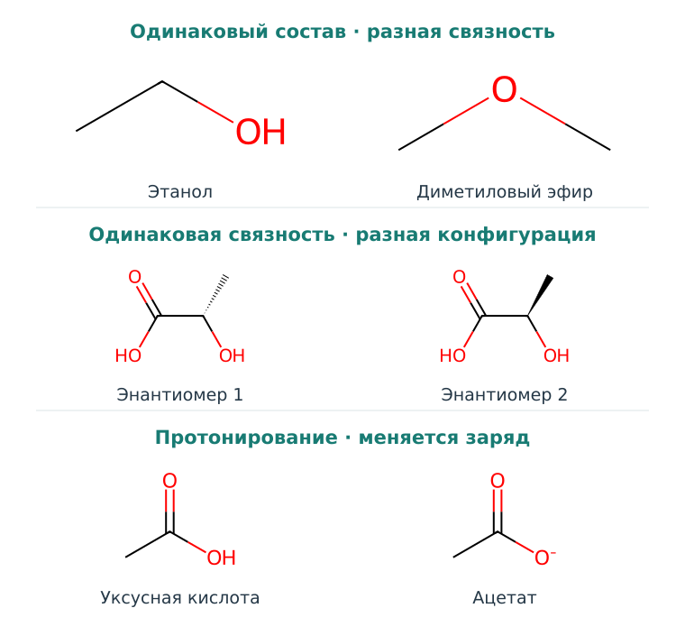
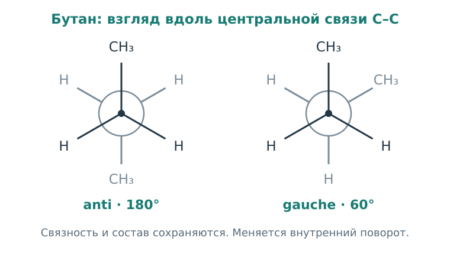

# Глава 2. Как читать молекулу

Две молекулы могут содержать одинаковое число атомов каждого элемента и вести себя по-разному. Иногда достаточно изменить место одной связи или расположение группы в пространстве. Иногда структура, нарисованная на странице, меняет заряд, оказавшись в другом растворе.

Чтобы понимать такие изменения, научимся читать структурную формулу как описание физических возможностей молекулы. Начнём со связности атомов, затем добавим форму, заряд и среду.

## 1. Чему вы научитесь

- читать простую скелетную формулу и находить функциональные группы;
- различать связность, стереохимию и конформацию;
- объяснять, почему протонирование зависит от pH;
- замечать, какую информацию теряет упрощённое представление молекулы.

## 2. Формула состава и структура

Запись C₂H₆O сообщает, какие атомы и в каком количестве входят в молекулу. Но она не говорит, как эти атомы соединены. Этанол CH₃–CH₂–OH и диметиловый эфир CH₃–O–CH₃ имеют одинаковый состав и разную связность.

В этаноле кислород связан с водородом; в эфире он соединяет два атома углерода. Эта разница меняет возможные взаимодействия с окружением. Уже здесь видно, почему молекулярной массы недостаточно, чтобы описать вещество.

  
  
<em>Рисунок 1. В верхней паре меняется связность при одинаковом составе. В средней — пространственная конфигурация при одинаковой связности. В нижней — состояние протонирования. Структуры нарисованы по явным SMILES с помощью RDKit.</em>

**Конституционные изомеры** имеют одинаковый состав и разную связность. Для компьютера этот уровень естественно записать в виде графа: вершины обозначают атомы, рёбра — связи. У вершины могут быть свойства, например элемент и формальный заряд; у ребра — тип связи.

Граф этанола по тяжёлым атомам — путь C–C–O. Граф диметилового эфира — C–O–C. Если стереть подписи элементов, останутся одинаковые пути из трёх вершин. Но химически подписи важны: они указывают, какой атом стоит в середине.

Это первый пример общей проблемы представлений. **Если признаки не сохраняют нужное различие, модель уже не сможет восстановить его из этих признаков.** В [первом практикуме](../part2/index.md) мы проверим это на маленьких графах без внешних библиотек.

### 2.1 Как читать скелетную формулу

В органической химии не всегда рисуют каждый атом и каждый водород. В скелетной записи угол или неподписанный конец линии обычно означает углерод. Водороды, связанные с углеродом, часто опускают; их число восстанавливают по валентности. Другие элементы, например N, O и Cl, подписывают явно.

Одна, две или три линии обозначают одинарную, двойную или тройную связь. В самых простых нейтральных примерах углерод образует четыре связи с учётом их порядка: двойная считается за две. Это удобная отправная точка для чтения, а заряды и особые случаи нужно рассматривать отдельно.

Например, в CH₃–CH₂–OH первый углерод соединён со вторым и тремя водородами. Второй — с первым углеродом, кислородом и двумя водородами. Кислород связан с углеродом и водородом. Когда мы сокращаем рисунок, молекула не теряет атомы; меняется только способ записи.

## 3. Почему важны функциональные группы

Электроны в связи не всегда распределены поровну. Более электроотрицательный атом сильнее притягивает электронную плотность. Поэтому связь O–H полярна: области около O и H по-разному взаимодействуют с окружающими зарядами и диполями.

Для первого знакомства удобно распознавать **функциональные группы** — фрагменты с характерными химическими возможностями. Спиртовая группа содержит O–H. Карбонильная — C=O. Карбоксильная объединяет C=O и O–H у одного углерода. Амин содержит азот с определённым окружением; амид — азот рядом с карбонильной группой.

Эти названия позволяют быстрее обсуждать молекулы, но поведение зависит и от соседних атомов. Например, электронная пара азота в амиде участвует в сопряжении с карбонильной группой. Поэтому свойства такого азота отличаются от свойств азота простого амина.

### 3.1 Донор и акцептор водородной связи

**Донор водородной связи** предоставляет подходящий водород, связанный с электроотрицательным атомом. **Акцептор** предоставляет область электронной плотности, способную участвовать в таком взаимодействии. Для многих простых нейтральных спиртов кислород может быть акцептором, а группа O–H — донором. У эфира есть кислород-акцептор, но нет O–H.

Поэтому в первом сравнении этанола и диметилового эфира мы уже могли заметить содержательное различие. Однако подсчёт N и O ещё не равен подсчёту доноров и акцепторов. Нужно учитывать связи, заряд и электронное окружение. Протонированный амин, например, теряет доступную свободную электронную пару азота для обычной акцепторной роли. При этом образовавшаяся N–H группа может участвовать как донор: протонирование меняет набор возможностей взаимодействия.

Такие возможности зависят от геометрии. Два подходящих фрагмента должны оказаться на подходящем расстоянии и быть правильно ориентированы. В главе о связывании мы добавим ещё одну часть картины: до встречи друг с другом оба фрагмента уже взаимодействовали с водой.

## 4. Одинаковая связность — разное пространство

Углерод с четырьмя одинарными связями часто имеет примерно тетраэдрическое окружение. Поэтому рисунок на плоскости скрывает важную информацию о расположении заместителей.

Если тетраэдрический атом углерода соединён с четырьмя разными заместителями, он является стереогенным центром. Два зеркальных расположения групп могут не совмещаться простым поворотом всей молекулы. Такие зеркальные стереоизомеры называют **энантиомерами**. На рисунке 1 показана пара для молочной кислоты; клиновидная связь передаёт пространственное направление.

Белковое окружение само имеет определённое пространственное устройство. Поэтому два энантиомера могут образовывать с ним разные наборы контактов. Одинаковая формула состава и одинаковый список связей не гарантируют одинакового биологического поведения.

Обозначения **R** и **S** описывают конфигурацию по правилам приоритета заместителей. Из буквы нельзя узнать, какой изомер активнее или в какую сторону он вращает плоскость поляризованного света. Для этих вопросов нужна дополнительная информация.

### 4.1 Конфигурация и конформация

Теперь представьте этанол и поверните одну часть молекулы вокруг одинарной связи. Состав и связность останутся прежними, а взаимное расположение атомов изменится. Такое пространственное состояние называют **конформацией**.

Разные конформации могут переходить друг в друга за счёт внутренних движений. Скорость перехода зависит от энергетического барьера. Мы не предполагаем, что любая одинарная связь вращается совершенно свободно: сопряжение, кольца и столкновения атомов могут сильно ограничивать движение.

Посмотрим вдоль центральной связи C–C бутана. Ближний атом углерода обозначим точкой, дальний — окружностью: они находятся друг за другом по линии взгляда. От каждого отходят одна группа CH₃ и два водорода. Если повернуть дальнюю часть молекулы вокруг этой связи, угол между направлениями на CH₃ изменится, а набор связей останется прежним.

  
  
<em>Рисунок 2. Проекции Ньюмена для двух конформаций бутана. Указан диэдральный угол между группами CH₃: 180° в anti и 60° в gauche. Точка и окружность обозначают ближний и дальний атомы углерода, а не дополнительные атомы или связи.</em>

Изменить конформацию и превратить один устойчивый энантиомер в другой — разные задачи. Обычный поворот вокруг связи не меняет конфигурацию устойчивого тетраэдрического центра. Поэтому полезно разделять три вопроса:

| Уровень | Что мы спрашиваем? |
| --- | --- |
| Связность | Кто с кем соединён? |
| Конфигурация | Как задано устойчивое пространственное расположение, например у стереоцентра? |
| Конформация | Как расположены атомы в выбранном состоянии внутреннего движения? |

В молекулярном моделировании это различие определяет, что именно мы ищем. Генерация конформеров одной молекулы обычно сохраняет заданную конфигурацию её стереоцентров.

## 5. Молекула в растворе может менять заряд

До сих пор мы мысленно держали молекулу отдельно. В растворе она обменивается взаимодействиями с окружением, а некоторые группы могут отдавать или принимать протон.

Рассмотрим простую кислоту:

$$
\mathrm{HA \rightleftharpoons H^+ + A^-}.
$$

HA — протонированная форма, A⁻ — депротонированная. В воде запись H⁺ является сокращением для гидратированного протона. При заданных температуре и составе среды равновесие описывает константа кислотности Kₐ. В идеальном разбавленном приближении:

$$
K_a\approx\frac{[H^+]}{c^\circ}\frac{[A^-]}{[HA]},
\qquad c^\circ=1\ \mathrm{M}.
$$

Стандартная концентрация $c^\circ$ делает выражение безразмерным. Обычно используют $pK_a=-\log_{10}K_a$ и, в том же приближении, $\mathrm{pH}=-\log_{10}([H^+]/c^\circ)$. Буква p означает переход к отрицательному десятичному логарифму: например, $10^{-5}$ превращается в 5.

Логарифм произведения равен сумме логарифмов. Поэтому после такого перехода определение Kₐ даёт $pK_a=\mathrm{pH}-\log_{10}([A^-]/[HA])$. Переносим последнее слагаемое и получаем **уравнение Хендерсона–Хассельбаха**:

$$
\mathrm{pH}=pK_a+\log_{10}\frac{[A^-]}{[HA]}.
$$

Квадратные скобки означают концентрацию. Формула показывает, что решающей величиной является **разница pH и pKₐ**. При pH = pKₐ концентрации форм равны. Если pH выше pKₐ на единицу, отношение [A⁻]/[HA] равно 10. Основы такого равновесия можно повторить в [разделе о кислотности](https://openstax.org/books/organic-chemistry/pages/2-8-acid-and-base-strength).

### 5.1 Разобранный пример

Для **учебной монопротонной кислоты** положим pKₐ = 5.0, pH = 6.0. Тогда:

$$
\frac{[A^-]}{[HA]}=10^{6-5}=10.
$$

Это отношение двух форм, а не их доли. Чтобы получить долю A⁻, делим её концентрацию на суммарную:

$$
f_{A^-}=\frac{[A^-]}{[A^-]+[HA]}=\frac{10}{10+1}\approx0.909.
$$

Около 91% молекул находятся в депротонированной форме в этой модели. При pH = 4.0 отношение станет 0.1, а доля A⁻ — около 9%. Структура углеродного скелета та же, но состав состояний заряда заметно меняется.

Для основания удобна запись $\mathrm{BH^+\rightleftharpoons B+H^+}$. Здесь pKₐ относится к сопряжённой кислоте BH⁺. При повышении pH доля нейтрального основания B увеличивается. Поэтому фразу «pKₐ молекулы» следует уточнять: о какой группе и каком равновесии идёт речь?

В молекуле с несколькими взаимодействующими кислотными и основными центрами картина сложнее. Первое приближение с одной группой учит читать равновесие, но его нельзя механически распространить на все возможные состояния.

### 5.2 Таутомерия — ещё один вид различия

**Таутомеры** различаются положением протона и связей и могут переходить друг в друга. Например, в кето-енольной паре перемещение протона сопровождается перестройкой двойной связи. Измениться могут расположение доноров и акцепторов и взаимодействие с белком.

Это не то же самое, что две резонансные формулы: резонансные записи описывают электронное строение одного состояния, а не молекулы, прыгающие между отдельными картинками.

При подготовке вещества к расчёту мы тем самым выбираем не только имя соединения, но и его конкретное представление: стереохимию, протонирование, таутомер и начальную конформацию.

## 6. Окружение — часть задачи

Полярные и заряженные участки молекулы взаимодействуют с водой. Неполярные участки тоже влияют на организацию растворителя. Если молекула переходит из воды в другое окружение, меняется весь набор взаимодействий.

Поэтому добавление полярной группы может одновременно изменить несколько свойств: взаимодействие с мишенью, растворимость, распределение между средами и предпочитаемые конформации. Направление итогового изменения зависит от контекста.

Представим, что к фрагменту добавили O–H в надежде получить новый контакт с белком. Сначала нужно проверить, помещается ли группа в выбранном месте и правильно ли ориентирована. Затем — что она теряет при уходе из воды и как влияет на остальные состояния молекулы. Такая постановка вопроса будет сопровождать нас в структурном дизайне.

## 7. Что увидит компьютер

Текстовая запись **SMILES** кодирует молекулярную структуру последовательностью символов. Например, `CCO` описывает этанол, а `COC` — диметиловый эфир. `OCC` тоже может описывать этанол: обход того же графа начался с другого конца. Принцип такой записи был систематизирован в работе [Weininger, 1988](https://doi.org/10.1021/ci00057a005).

Отсюда следуют два разных требования к представлению. Оно должно сохранять важные химические различия и одновременно не создавать искусственных различий из-за произвольного порядка записи.

Если модель даёт разные предсказания только потому, что мы перенумеровали атомы той же структуры, стоит проверить её **инвариантность к перестановкам**. Если она всегда считает два стереоизомера одинаковыми, стоит проверить, передали ли мы ей информацию о стереохимии. Так химические понятия превращаются в конкретные вопросы к коду.

В шестой главе мы подробно разберём представления. Пока достаточно понимать, почему одна строка не является самой молекулой.

## 8. Итоги и задачи

### 8.1 Краткий итог

Состав, связность, стереохимия, конформация и состояние протонирования отвечают на разные вопросы. Для взаимодействия важны также среда и доступные состояния молекулы. Хорошее представление сохраняет различия, необходимые для нашей задачи.

### 8.2 Проверьте понимание

1. Почему C₂H₆O недостаточно для определения структуры? Нарисуйте две возможные молекулы.
2. Какие возможности водородного связывания различают этанол и диметиловый эфир?
3. Два рисунка отличаются поворотом вокруг одинарной связи. Как проверить, описывают ли они разные конформации или разные конфигурации?
4. Почему одинаковая связность атомов не гарантирует одинакового взаимодействия с белком?

### 8.3 Задачи

5. Для учебной монопротонной кислоты pKₐ = 6.0. Вычислите долю депротонированной формы при pH 5.0, 6.0 и 7.0. Сначала предскажите порядок значений.
6. Для учебного основания pKₐ сопряжённой кислоты BH⁺ равен 8.0. При pH 7.0 какая форма преобладает? Вычислите долю B.
7. Представление хранит только числа атомов C, N и O. Какие различия из этой главы оно потеряет? Какие из них может сохранить граф с элементами и порядками связей, но без стереометок?
8. Выполните [практикум о молекулярной идентичности](../part2/index.md). Объясните, почему нужно сохранять подписи атомов, но не их произвольные номера.

**★ Расширение.** Взяв равновесие HA ⇌ H⁺ + A⁻, выведите формулу $f_{A^-}=1/(1+10^{pK_a-\mathrm{pH}})$. Какие предположения позволяют описывать систему всего двумя формами?

Теперь у нас есть язык для описания молекулы. В следующей главе мы применим его к гораздо более крупному партнёру — белку.

## Источники и дальнейшее чтение

- [Weininger, 1988. SMILES, a chemical language and information system](https://doi.org/10.1021/ci00057a005). Знаковая работа о текстовом представлении молекулярной связности; подробный разбор предстоит в главе 6.
- [RDKit: Getting Started in Python](https://www.rdkit.org/docs/GettingStartedInPython.html). Официальные примеры чтения, изображения и сравнения структур.
- [OpenStax / McMurry: Acid and Base Strength](https://openstax.org/books/organic-chemistry/pages/2-8-acid-and-base-strength). Учебное объяснение Kₐ, pKₐ и сопряжённых пар; раздел для повторения основ.
- [IUPAC Gold Book](https://goldbook.iupac.org/). Справочник химических терминов для дальнейшего уточнения определений.
