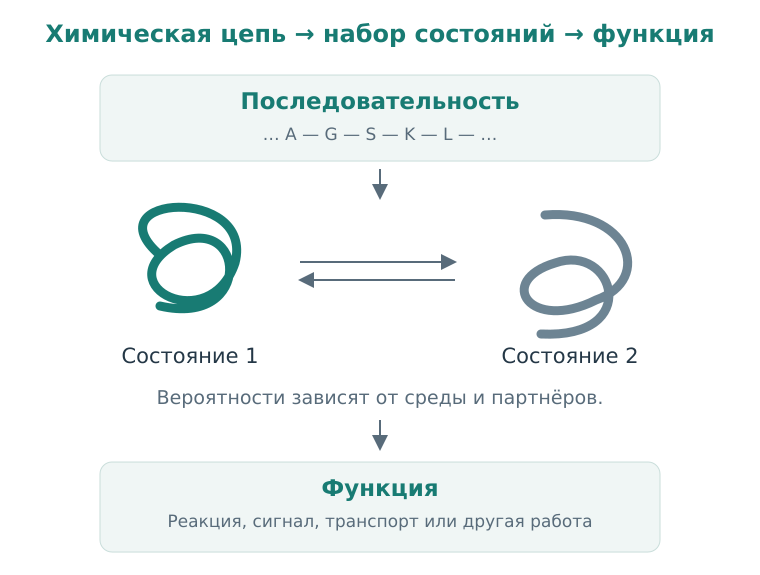

# Глава 3. Белок в движении

Мы научились видеть за структурной формулой связи, форму и заряд. Белок состоит из тех же физических объектов — атомов и связей. Но его размер и устройство позволяют выполнять сложную работу: ускорять реакции, передавать сигналы и переносить вещества через мембраны.

Чтобы понять, как молекула меняет эту работу, нужно связать три вещи: последовательность белка, его пространственные состояния и функцию. Начнём с того, как построен белок, а затем посмотрим, что именно может изменить лиганд.

## 1. Чему вы научитесь

- объяснить, чем последовательность белка отличается от его структуры;
- различить карман связывания, каталитическую функцию и клеточный эффект;
- понимать, почему белок следует представлять как подвижную систему;
- читать запись о структуре, замечая её происхождение и границы.

## 2. От аминокислоты к цепи

Белки состоят из аминокислотных остатков, соединённых пептидными связями. У большинства обычных аминокислот есть общий фрагмент основной цепи, а различаются они боковой группой. В состав таких групп входят неполярные, полярные, кислотные и основные фрагменты — те самые химические возможности, с которыми мы знакомились в предыдущей главе.

Когда аминокислоты соединяются, образуется повторяющийся **backbone**, или основная цепь. Порядок остатков называют **первичной структурой**, а его текстовую запись — последовательностью. В записи используются одно- или трёхбуквенные обозначения аминокислот.

У цепи есть направление: от N-конца к C-концу. Это направление важно и для биосинтеза, и для записи данных. Две последовательности нельзя считать одинаковыми, просто прочитав одну задом наперёд.

Боковая группа может менять локальные взаимодействия, но её роль определяется окружением. Заряженный остаток на поверхности контактирует с водой; похожий остаток внутри белка оказывается в другой среде. Поэтому даже знакомая функциональная группа приобретает смысл через своё положение.

## 3. Как цепь организуется в пространстве

В пептидной связи есть частичный характер двойной связи, поэтому вращение вокруг неё ограничено. Зато повороты вокруг соседних связей основной цепи позволяют менять направление цепочки. Не все сочетания углов одинаково возможны: атомы не могут свободно проходить сквозь друг друга.

Локально цепь часто образует повторяющиеся структуры. В **α-спирали** backbone закручен в спираль; в **β-структуре** вытянутые участки образуют лист. Эти элементы стабилизируются, в частности, водородными связями основной цепи. Их называют вторичной структурой.

Общая пространственная организация одной цепи — третичная структура. Несколько цепей могут образовать функциональный комплекс; тогда говорят о четвертичной структуре. Эти названия полезны как уровни описания, но сами по себе ещё не объясняют, что делает белок.

  
  
<em>Рисунок 1. Последовательность задаёт химическое устройство цепи. В заданной среде белок занимает набор состояний, через которые реализуется его функция. Схема условная, формы не являются координатами реального белка.</em>

### 3.1 Почему белок складывается

При изменении формы цепи меняются взаимодействия внутри неё и с окружающей средой. Одни расположения позволяют спрятать неполярные участки от воды, другие создают выгодные контакты или уменьшают столкновения атомов. При этом упорядочивание ограничивает число доступных состояний цепи.

Итог определяется балансом этих факторов. В следующей главе мы выразим подобный баланс через свободную энергию. Сейчас достаточно заметить: подходящая форма возникает в конкретной среде и зависит от химического устройства цепи.

Исторический вход в эту тему — работы Анфинсена о сворачивании белков. Они связали информацию в последовательности с возможностью восстановить структуру и активность при подходящих условиях. Для дальнейшего чтения: [Anfinsen, 1973](https://doi.org/10.1126/science.181.4096.223) и его [Нобелевская лекция](https://www.nobelprize.org/prizes/chemistry/1972/anfinsen/lecture/).

Эта идея не требует считать, что всякий белок всегда имеет одну устойчивую форму. Есть гибкие участки, неупорядоченные области, комплексы с партнёрами и зависимость от среды. В клетке в сворачивании и поддержании белков также участвуют другие молекулярные системы.

## 4. Структура — это наблюдение о состоянии

Когда мы открываем PDB-файл, перед нами координаты атомов в структурной модели. Такая модель могла быть получена на основе рентгеновской дифракции, cryo-EM, NMR или вычислительного предсказания. Происхождение важно: методы наблюдают систему по-разному и имеют разные источники неопределённости.

Например, в экспериментальной модели могут отсутствовать гибкие участки, для которых недостаточно данных. В структуре может находиться только выбранный домен белка, а не полная цепь. В условиях исследования могут присутствовать дополнительные партнёры и вещества.

Поэтому полезно спросить: **какой именно объект представлен этими координатами?** Название белка — только начало ответа. Нужно знать последовательность, вид организма, мутации, партнёров и метод получения структуры.

### 4.1 Белок занимает несколько состояний

Атомы белка движутся. Иногда это небольшие колебания, иногда — смена положения петли или относительного расположения доменов. Разные состояния имеют разные вероятности и могут выполнять разную функцию.

Представим белок, у которого карман то более открыт, то более закрыт. Лиганд лучше взаимодействует с открытым состоянием. Появление лиганда может изменить соотношение состояний: связанные формы получают дополнительную стабилизацию. В других случаях после начального контакта происходят дальнейшие перестройки белка и лиганда.

Для этих сторон распознавания используют термины **conformational selection** и **induced fit**. В реальном процессе могут присутствовать оба механизма. По одной финальной картинке комплекса обычно нельзя восстановить весь путь его образования.

Классическая работа [Monod, Wyman и Changeux, 1965](https://doi.org/10.1016/S0022-2836(65)80285-6) предлагает модель, в которой связывание связано с распределением между конформационными состояниями. Это исторический источник для углубления; её конкретные предположения о субъединицах и переходах не являются универсальным описанием любого белка.

## 5. Какие функции становятся мишенями

### 5.1 Фермент: изменить скорость реакции

**Фермент** ускоряет химическую реакцию. Он помогает системе пройти путь между реагентами и продуктами с меньшим активационным барьером. При этом катализатор не меняет положение равновесия самой реакции.

У фермента часто есть участок, в котором связывается субстрат и происходит каталитическая работа. Молекула-ингибитор может препятствовать связыванию субстрата, влиять на каталитические группы или менять доступные состояния фермента.

Киназы — пример ферментов, переносящих фосфатную группу, часто с ATP на другой субстрат. Их активность может участвовать в передаче клеточных сигналов. Поэтому молекулярное изменение активности киназы способно повлиять на процессы дальше по сигнальному пути. Какое именно влияние получится, нужно изучать в соответствующей системе.

### 5.2 Рецептор: изменить вероятность ответа

**Рецептор** распознаёт сигнал и участвует в передаче ответа. Лиганд, который активирует рецептор, называют агонистом. Антагонист препятствует действию агониста; само связывание антагониста не означает тот же функциональный ответ.

Это важный пример различия между **affinity** — характеристикой связывания — и **efficacy** — способностью вызвать ответ в определённой системе. Два вещества могут связываться с одним рецептором и по-разному влиять на его функцию.

### 5.3 Другие способы вмешательства

Каналы регулируют прохождение ионов, транспортёры перемещают вещества, а структурные и регуляторные белки организуют клеточные процессы. Кроме изменения текущей активности, можно воздействовать на количество белка. Например, стратегия targeted protein degradation направлена на его удаление через клеточные механизмы деградации.

Для начала не требуется запоминать все классы. Важнее задавать один вопрос: **какое действие белка мы меняем и как это обнаружим?** Ответ определяет выбор assay и смысл вычислительной задачи.

## 6. Где связывается лиганд

**Binding site** — участок, с которым взаимодействует лиганд. Часто его удобно описывать как карман, но это не обязательно жёсткая полость. Участок может находиться на поверхности, на границе доменов или между белковыми партнёрами.

Карман имеет геометрию и химические свойства. Одна область может предоставлять донор водородной связи, другая — заряженную группу, третья — неполярную поверхность. Чтобы обсудить предполагаемое взаимодействие, нужно совместить эту карту с химией лиганда.

Связывание в **аллостерическом участке** меняет функцию через влияние на другие участки или состояния белка. Пространственное расстояние от каталитического центра не исключает функционального эффекта. Но сам факт нахождения молекулы на поверхности ещё не доказывает такую связь.

### 6.1 Возвращаемся к ABL

В первой главе мы познакомились с иматинибом. Запись [PDB 1IEP](https://www.rcsb.org/structure/1IEP) представляет киназный домен c-ABL мыши в комплексе с этим соединением. Это рентгеновская структура с разрешением 2.10 Å, а не структура полного человеческого BCR–ABL в клетке.

В связанной с записью работе [Nagar и соавторов, 2002](https://pubmed.ncbi.nlm.nih.gov/12154025/) показано, что иматиниб связывается в области ATP-связывающего участка и стабилизирует определённую неактивную конформацию. Такой результат связывает расположение лиганда с состоянием фермента.

Этот пример полезен и как упражнение в чтении данных. История лекарства, белковая мишень и конкретная запись структуры связаны между собой, но описывают разные объекты и уровни исследования. Открыв запись, нужно сохранить её точную идентичность.

## 7. От белка к клетке

Предположим, мы уверенно показали, что молекула связывается с белком и уменьшает его активность. Чтобы объяснить клеточный эффект, остаются дополнительные вопросы. Присутствует ли этот белок в исследуемых клетках? Достигает ли его молекула? Насколько сильно другие процессы компенсируют изменение?

Кроме того, соединение может взаимодействовать с несколькими белками. **Селективность** всегда относится к сравнению: к каким мишеням, при каких условиях и по какому измерению? Знание об одной сильной связи ещё ничего не сообщает обо всех остальных.

Мы будем возвращаться к этим вопросам в томах Target Discovery и Target Deconvolution. Сейчас у нас уже есть нужная основа: белок — химическая, подвижная система, а его функция существует в определённом контексте.

## 8. Итоги и задачи

### 8.1 Краткий итог

Последовательность задаёт химическое устройство белка. Структурные состояния помогают понять его функции и взаимодействия. Координаты конкретной модели полезны, когда мы знаем, какой объект и какие условия они описывают.

### 8.2 Проверьте понимание

1. Чем различаются последовательность, структура и функция белка? Приведите по одному вопросу, на который отвечает каждый уровень.
2. Почему изображение комплекса не показывает весь процесс его образования?
3. Два лиганда связываются с одним рецептором, но только один вызывает выбранный ответ. Какие два понятия помогают описать это различие?
4. Почему удалённый от активного центра участок может быть интересен для дизайна?

### 8.3 Задача со структурной записью

5. Откройте [1IEP](https://www.rcsb.org/structure/1IEP). Выпишите метод, организм, название белковой конструкции и лиганда. Какое утверждение точнее: «структура белка заболевания» или «структура определённого домена с определённым лигандом»? Объясните, какие сведения теряет первая формулировка.
6. **Учебная ситуация:** в структуре часть петли не разрешена. Можно ли считать, что этой петли нет в исследованном белке? Какие данные стоит проверить?
7. Предположим, лиганд предпочитает редкое состояние белка. Какие вопросы о подготовке структуры и выборе конформации стоит задать до docking?

**★ Расширение.** Придумайте два возможных объяснения ситуации, когда ингибирование очищенного фермента подтверждено, а ожидаемый клеточный эффект отсутствует. Укажите, какое из объяснений относится к молекуле, а какое — к биологической гипотезе.

В следующей главе переведём слово «связывание» в количественную модель. Она позволит рассчитать, какая доля белка занята лигандом и как эта доля зависит от концентрации.

## Источники и дальнейшее чтение

- [Anfinsen, 1973. Principles that govern the folding of protein chains](https://doi.org/10.1126/science.181.4096.223). Историческая работа о связи последовательности, сворачивания и функции.
- [Monod, Wyman & Changeux, 1965. On the nature of allosteric transitions: a plausible model](https://doi.org/10.1016/S0022-2836(65)80285-6). Классическая модель связи лигандного связывания с конформационными состояниями.
- [Nagar et al., 2002](https://pubmed.ncbi.nlm.nih.gov/12154025/) и [PDB 1IEP](https://www.rcsb.org/structure/1IEP). Конкретный пример комплекса киназы с ингибитором.
- [Stanford CS279](https://web.stanford.edu/class/cs279/). Университетский маршрут для дальнейшего изучения структуры и динамики.
