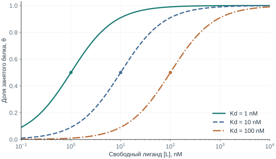
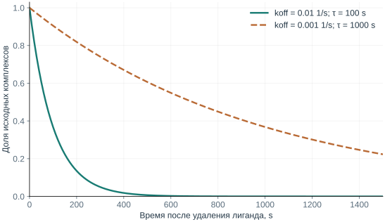

# Глава 4. Что значит «связывается»

Молекулы в растворе постоянно движутся. Лиганд встречает белок, образует комплекс, затем может отделиться. Даже если средняя доля связанных белков не меняется, отдельные комплексы продолжают возникать и распадаться.

В этой главе построим простую модель такого процесса. Из неё появятся три разных вопроса: насколько выгодно связывание, какая доля белка занята и как быстро система меняется. Для каждого вопроса нужна своя величина.

## 1. Чему вы научитесь

- вывести связь между Kd, свободной концентрацией лиганда и occupancy;
- проверить размерности и использовать логарифмическую шкалу affinity;
- объяснить, почему одинаковый Kd не означает одинаковое время жизни комплекса;
- заметить, когда приближение «добавленная концентрация равна свободной» перестаёт работать.

## 2. Самая простая модель

Обозначим свободный белок P, свободный лиганд L, а их комплекс PL:

$$
\mathrm{P+L\underset{k_{off}}{\stackrel{k_{on}}{\rightleftharpoons}}PL}.
$$

Будем считать, что у белка один независимый участок связывания, комплекс содержит одну молекулу лиганда, взаимодействие обратимо, а среда однородна. Других реакций в этой модели нет. Эти предположения делают задачу достаточно простой, чтобы пройти её от начала до конца.

Вероятность встречи растёт, когда увеличивается концентрация любого из партнёров. Поэтому скорость образования комплекса в модели пропорциональна произведению $[P][L]$:

$$
v_{on}=k_{on}[P][L].
$$

Скорость распада пропорциональна концентрации уже существующего комплекса:

$$
v_{off}=k_{off}[PL].
$$

Если концентрации измеряются в моль/л, или M, то единицы $k_{on}$ — M⁻¹s⁻¹, а $k_{off}$ — s⁻¹. В обоих случаях скорость получается в M/s. Эта проверка размерностей — быстрый способ убедиться, что мы не перепутали величины.

## 3. Равновесие и Kd

При равновесии скорости образования и распада комплекса равны:

$$
k_{on}[P][L]=k_{off}[PL].
$$

Перенесём концентрации в одну сторону:

$$
K_d=\frac{k_{off}}{k_{on}}=\frac{[P][L]}{[PL]}.
$$

Так мы получили **константу диссоциации Kd**. В принятом концентрационном приближении она имеет единицы концентрации. Малый Kd означает, что при прочих равных для значительной связанности достаточно меньшей свободной концентрации лиганда. Это соответствует более высокой affinity.

Слово «равновесие» здесь не означает остановку молекул. Оно означает отсутствие направленного изменения средних концентраций: сколько комплексов в среднем образуется за единицу времени, столько же распадается.

Kd относится к определённым партнёрам и условиям. Температура, pH, состав среды и состояние белка могут менять наблюдаемое взаимодействие. Поэтому полезно записывать условия рядом с числом.

## 4. Какая доля белка занята

Суммарная концентрация белка складывается из свободного и связанного:

$$
[P]_{tot}=[P]+[PL].
$$

**Occupancy**, или доля занятых белковых молекул, равна:

$$
\theta=\frac{[PL]}{[P]_{tot}}=\frac{[PL]}{[P]+[PL]}.
$$

Из определения Kd следует $[P]=K_d[PL]/[L]$. Подставим это в знаменатель и сократим $[PL]$:

$$
\theta=\frac{1}{K_d/[L]+1}
=\boxed{\frac{[L]}{K_d+[L]}}.
$$

Теперь можно прочитать свойства кривой без вычислительной программы. Если свободного лиганда почти нет, occupancy близка к нулю. Если его намного больше Kd, occupancy приближается к единице. Когда $[L]=K_d$, получаем ровно 1/2.

### 4.1 Численный пример

Возьмём **учебную пару** с Kd = 10 nM. Все величины в дроби будем выражать в nM:

| Свободный лиганд [L] | Расчёт | Occupancy |
| --- | --- | --- |
| 1 nM | 1 / (10 + 1) | 9.1% |
| 10 nM | 10 / (10 + 10) | 50% |
| 90 nM | 90 / (10 + 90) | 90% |
| 990 nM | 990 / (10 + 990) | 99% |

Переход от 90% к 99% потребовал увеличить свободную концентрацию в 11 раз. По мере заполнения оставшиеся свободные участки становятся редкими, и кривая приближается к насыщению постепенно.

<div align="center">
  
  <p><em>Рисунок 1. Точные кривые модели одного независимого участка при равновесии. Значения Kd выбраны для обучения, экспериментальных данных на графике нет. Логарифмическая ось концентрации позволяет сравнивать несколько порядков величины.</em></p>
</div>

### 4.2 Попробуйте предсказать результат

Сначала установите свободную концентрацию равной Kd. Затем увеличьте Kd в десять раз, оставив концентрацию прежней. Как должна измениться occupancy?

```python
# Концентрации заданы в nM.
ligand_free = 10
for kd in (10, 100):
    occupancy = ligand_free / (kd + ligand_free)
    print(kd, round(100 * occupancy, 2))
```

Выполните расчёт самостоятельно, затем сравните его с [полным практикумом](../part2/Chapter2_Binding-Model.md). Код, таблица и рисунок используют одну аналитическую модель.

### 4.3 Два разных смысла слова «сильнее»

Предположим, у A Kd = 10 nM, у B — 100 nM. При одинаковой свободной концентрации A будет занимать большую долю одинаковых белковых участков. Но если концентрации различаются, одних Kd недостаточно.

При $[A]=10$ nM occupancy A равна 50%. При $[B]=1000$ nM occupancy B составляет примерно 91%. Поэтому вопрос «какое соединение сильнее связывается?» и вопрос «какая доля мишени занята в этих условиях?» нужно разделять.

Следующий переход — от occupancy к функции — также требует модели. Если связанный лиганд блокирует фермент, доля занятых участков может быть связана с уменьшением активности. Для рецептора важны ещё состояния и способность лиганда вызывать ответ. Биологический эффект не следует автоматически из одного числа θ.

## 5. Добавленная концентрация и свободная

В формуле стоит концентрация **свободного** лиганда. В лаборатории мы часто знаем, сколько вещества добавили всего:

$$
[L]_{tot}=[L]+[PL].
$$

Если связывается лишь малая часть добавленного лиганда, удобно считать $[L]\approx[L]_{tot}$. Но при заметном расходовании лиганда на комплекс это приближение завышает свободную концентрацию.

Проверим на **учебном примере**: суммарно имеется 100 nM белка, 100 nM лиганда и Kd = 10 nM. Если подставить добавленные 100 nM в простую формулу, получится примерно 91%. Однако свободного лиганда после связывания будет меньше 100 nM.

Обозначим $x=[PL]$. Тогда $[P]=[P]_{tot}-x$ и $[L]=[L]_{tot}-x$. Подставляем в определение Kd:

$$
K_d=\frac{([P]_{tot}-x)([L]_{tot}-x)}{x}.
$$

После раскрытия скобок получается квадратное уравнение:

$$
x^2-([P]_{tot}+[L]_{tot}+K_d)x+[P]_{tot}[L]_{tot}=0.
$$

Нужен корень, который не превышает концентрацию ни одного партнёра. Для выбранных чисел $x\approx72.98$ nM. Значит, свободного лиганда примерно 27.02 nM, а occupancy — 72.98%.

Разница с 91% возникла не из-за нового типа связывания. Мы просто точнее учли баланс вещества. Этому и другим условиям измерения посвящена работа [Jarmoskaite и соавторов, 2020](https://doi.org/10.7554/eLife.57264).

## 6. От affinity к свободной энергии

При образовании комплекса меняется целая система: белок, лиганд и растворитель. Возникают новые контакты, часть прежних взаимодействий с водой меняется, а набор доступных движений может сужаться или расширяться.

Эти вклады объединяет **свободная энергия Гиббса**. При заданной температуре:

$$
\Delta G=\Delta H-T\Delta S.
$$

ΔH описывает энтальпийную часть изменения, ΔS — изменение энтропии, T — абсолютную температуру. Простое правило «больше контактов — лучше связывание» не учитывает все эти вклады.

В идеальном разбавленном приближении стандартная свободная энергия связывания связана с Kd:

$$
\Delta G^\circ_{bind}=RT\ln\left(\frac{K_d}{c^\circ}\right),
\qquad c^\circ=1\ \mathrm{M}.
$$

R — газовая постоянная. Отношение внутри логарифма безразмерно; поэтому численное значение Kd сначала переводят в M. Деление на стандартную концентрацию нельзя мысленно заменить подстановкой числа в любых удобных единицах.

Например, 10 nM = $10^{-8}$ M. При T = 298 K получаем примерно −45.6 kJ/mol для стандартной свободной энергии связывания этой **учебной системы**. Это ΔG° для выбранного стандартного состояния; фактическое изменение свободной энергии реакции при равновесных концентрациях равно нулю.

### 6.1 Что означает десятикратное улучшение

Сравним Kd = 100 nM и 10 nM при той же температуре. Разность стандартных свободных энергий:

$$
\Delta\Delta G^\circ=RT\ln\frac{10}{100}
=-RT\ln10\approx-5.7\ \mathrm{kJ/mol}.
$$

Эта небольшая по молекулярным энергетическим масштабам разность соответствует целому порядку величины в Kd. Логарифмическая связь объясняет, почему сравнительно небольшие изменения общего энергетического баланса могут заметно сдвинуть affinity.

По той же причине часто используют $pK_d=-\log_{10}(K_d/1\mathrm{M})$. Для 100 nM pKd = 7, для 10 nM — 8. Чем выше pKd, тем ниже Kd и выше affinity в сравнимых условиях.

## 7. Одинаковое равновесие, разная скорость

Мы получили $K_d=k_{off}/k_{on}$. Одно отношение может возникнуть из разных пар чисел:

| Учебная система | kon, M⁻¹s⁻¹ | koff, s⁻¹ | Kd |
| --- | --- | --- | --- |
| A | $10^6$ | $10^{-2}$ | 10 nM |
| B | $10^5$ | $10^{-3}$ | 10 nM |

При одинаковой свободной концентрации и после достижения равновесия их occupancy будет одинаковой. Но B образует и теряет комплекс медленнее.

Представим, что свободный лиганд удалили и повторного связывания нет. Тогда остаётся только распад:

$$
\frac{d[PL]}{dt}=-k_{off}[PL],
\qquad [PL](t)=[PL](0)e^{-k_{off}t}.
$$

Среднее время жизни комплекса в этой модели — $\tau=1/k_{off}$. Для A это 100 s, для B — 1000 s. Время, за которое распадается половина исходных комплексов, другое: $t_{1/2}=\ln2/k_{off}$.

<div align="center">
  
  <p><em>Рисунок 2. Нормированная концентрация комплекса после удаления свободного лиганда. Учебная модель предполагает отсутствие повторного связывания; одинаковый Kd не делает эти кривые одинаковыми.</em></p>
</div>

В живой системе лиганд может снова связаться, белок — перейти в другое состояние или обновиться. Поэтому время действия вещества нельзя просто приравнять к $1/k_{off}$. Но уже эта простая модель показывает, почему равновесная и кинетическая характеристики дополняют друг друга.

## 8. Итоги и задачи

### 8.1 Краткий итог

Kd описывает равновесное взаимодействие при заданных условиях. Occupancy зависит ещё и от свободной концентрации. Скорости образования и распада комплекса определяют, как система приходит к равновесию и покидает его.

### 8.2 Проверьте понимание

1. Почему при равновесии комплексы продолжают образовываться и распадаться?
2. Как проверить единицы в выражении $K_d=k_{off}/k_{on}$?
3. Почему в формуле occupancy используется свободная концентрация?
4. Что добавляет информация о koff, если Kd уже известен?

### 8.3 Задачи

Все числа ниже учебные. Используйте модель одного независимого участка.

5. Kd = 20 nM. Вычислите occupancy при свободных концентрациях 2, 20 и 180 nM. Сначала оцените ответы без калькулятора.
6. Выведите формулу свободной концентрации, необходимой для заданной occupancy. Какая концентрация требуется для θ = 0.95 при Kd = 20 nM?
7. Переведите Kd = 50 nM в pKd. Что изменится в pKd при десятикратном уменьшении Kd?
8. У двух систем одинаковый Kd = 10 nM. Для первой kon = $2\times10^5$ M⁻¹s⁻¹, для второй — $2\times10^6$ M⁻¹s⁻¹. Найдите koff и среднее время жизни комплекса для каждой.
9. Выполните [практикум о связывании](../part2/index.md). В примере с расходованием лиганда проверьте, что ни свободная, ни связанная концентрация не становятся отрицательными.

**★ Расширение.** При постоянной свободной концентрации L покажите, что скорость приближения к равновесию задаётся $k_{on}[L]+k_{off}$. Почему короткое время инкубации может мешать измерению Kd?

Следующая глава будет посвящена эксперименту: как из наблюдаемого сигнала получить характеристику системы и почему Kd, Ki, IC50 и EC50 отвечают на разные вопросы. Она пока находится в [программе курса](../index.md#программа).

## Источники и дальнейшее чтение

- [Jarmoskaite et al., 2020. How to measure and evaluate binding affinities](https://doi.org/10.7554/eLife.57264). Условия равновесного измерения, диапазоны концентраций и интерпретация binding assays.
- [Monod, Wyman & Changeux, 1965](https://doi.org/10.1016/S0022-2836(65)80285-6). Классический переход к более сложным системам со связанными конформационными состояниями.
- [Stanford CS279](https://web.stanford.edu/class/cs279/). Следующий уровень изучения энергий и молекулярной динамики.

Численные примеры и графики в этой главе рассчитаны из явно заданных учебных параметров. Они не являются экспериментальными оценками affinity какого-либо препарата.
